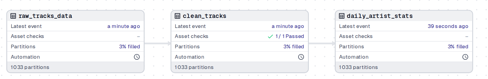
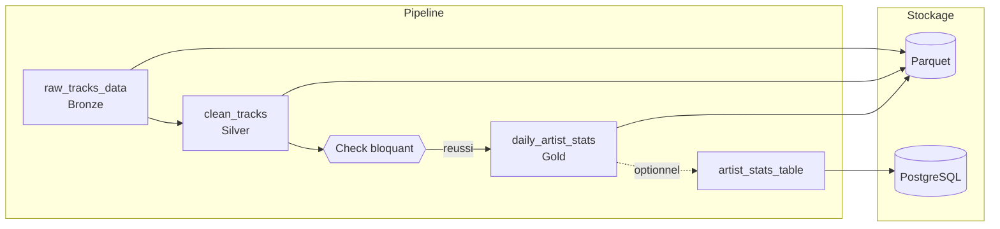

# Dagster Test Bench

**Banc d'essai pour apprendre l'orchestrateur de données Dagster sur un pipeline musical partitionné par jour, en local et avec des données simulées.**


[](https://github.com/floSa/Dagster-Test-Bench/actions/workflows/ci.yml)
[](LICENSE)

## Sommaire

- [Architecture](#architecture)
- [Documentation](#documentation)
- [Démarrage](#démarrage)
- [Configuration](#configuration)
- [Tests](#tests)
- [Structure du projet](#structure-du-projet)
- [Licences & composants](#licences--composants)

## Architecture





**Ce que le pipeline met en œuvre :**

- **Assets en architecture médaillon,** rangés en groupes : `raw_tracks_data` (Bronze) → `clean_tracks` (Silver) → `daily_artist_stats` (Gold).
- **Partitions journalières** depuis le 2024-01-01, avec rattrapage (*backfill*).
- **Check qualité bloquant et partitionné :** `clean_tracks_id_not_null`, et un moyen de le faire échouer à la demande.
- **IO Manager personnalisé :** écriture et lecture en Parquet dans `data/`, avec les métadonnées standard de Dagster.
- **Job et schedule quotidiens,** arrêtés par défaut, qui traitent la veille à 00:00 UTC.
- **Automatisation :** Declarative Automation, sensors de fichier et d'échec, politique de fraîcheur, retries, file d'attente des runs, dépendance entre partitions.
- **PostgreSQL :** ressource configurable, mot de passe lu dans l'environnement, export de Gold et relance après une panne de la base. Docker est nécessaire pour cette partie uniquement.
- **Structure `dg` :** tout ce qui est placé dans `src/streamify_ops/defs/` est chargé automatiquement.

> Détails : [documentation/architecture.md](documentation/architecture.md)

## Documentation

| Objectif | À lire |
|---|---|
| Apprendre en manipulant : commande, écran, fichier, étape par étape | [Tutoriel](TUTORIAL.md) |
| Comprendre le projet et retrouver une information, dépannage compris | [Manuel utilisateur](documentation/manuel-utilisateur.md) |
| Connaître les composants, les flux, les décisions et les limites | [Architecture](documentation/architecture.md) |
| Savoir où vont les données et comment repartir de zéro | [Stockage](documentation/STORAGE.md) |
| Connaître les secrets, l'exposition réseau, l'audit et les risques | [Sécurité](documentation/SECURITY.md) |

## Démarrage

**Prérequis :** [`uv`](https://docs.astral.sh/uv/), qui installe lui-même Python 3.12. Docker n'est nécessaire que pour PostgreSQL.

```bash
uv sync --extra dev
```

```bash
export DAGSTER_HOME="$PWD/.dagster_home"
```

```bash
mkdir -p "$DAGSTER_HOME"
```

```bash
uv run dg dev
```

Exporter `DAGSTER_HOME` dans chaque terminal utilisé : c'est ce qui relie les commandes à l'interface.

| Service | Adresse | Note |
|---|---|---|
| Interface Dagster | [http://localhost:3000](http://localhost:3000) | Démarrée par `dg dev` |
| PostgreSQL | `localhost:5434` | Optionnel, démarré par `docker compose up -d --wait` : [étape 10 du tutoriel](TUTORIAL.md#10-publier-dans-postgresql) |

## Configuration

Toute la configuration passe par des variables d'environnement.

| Variable | Défaut | Effet |
|---|---|---|
| `DAGSTER_HOME` | Aucun | Dossier de l'historique. Sans valeur commune, une commande et l'interface ne partagent pas la même instance |
| `STREAMIFY_DATA_DIR` | `data/` à la racine du projet | Dossier des fichiers Parquet, des alertes et de l'inbox |
| `STREAMIFY_FAST_AUTOMATION` | Non défini | `1` : cron chaque minute, fraîcheur à 2 puis 4 minutes, pour les observer sans attendre |
| `STREAMIFY_PG_PASSWORD` | Aucun | Mot de passe de la base, exigé par Docker Compose et par l'export PostgreSQL |

## Tests

```bash
uv run pytest
```

**23 tests** passent avec la base démarrée et `STREAMIFY_PG_PASSWORD` exporté. Sans cette variable, 21 passent et 2 sont ignorés. Les tests n'utilisent ni l'instance ni `data/`, mais ceux qui exigent une vraie base suppriment la table `artist_stats`.

Contrôles complémentaires, également exécutés par la [CI](.github/workflows/ci.yml) :

```bash
uv run black --check .
```

```bash
uv run dg check defs
```

## Structure du projet

```text
Dagster-Test-Bench/
├── src/streamify_ops/
│   ├── definitions.py                      # Charge tout le dossier defs/
│   ├── settings.py                         # Dossier de données, mode accéléré
│   ├── defs/
│   │   ├── assets/
│   │   │   ├── ingestion.py                # Bronze : raw_tracks_data, partitions
│   │   │   ├── transformation.py           # Silver : clean_tracks, check bloquant
│   │   │   └── analytics.py                # Gold : daily_artist_stats
│   │   ├── resources.py                    # Déclare l'IO Manager
│   │   ├── jobs.py                         # daily_streamify_job
│   │   ├── schedules.py                    # daily_streamify_schedule
│   │   └── sensors.py                      # Arrivée de fichier, échec de run
│   ├── optional/
│   │   ├── weekly_artist_stats.py          # Cumul sur 7 jours, à copier dans defs/assets/
│   │   └── artist_stats_table.py           # Export PostgreSQL, à copier dans defs/assets/
│   └── resources/
│       ├── local_filesystem_io_manager.py  # Stockage Parquet
│       └── postgres.py                     # Connexion PostgreSQL
├── tests/                                  # Assets, check, schedule, sensors, automatisation
├── scripts/capture_docs.py                 # Régénère les captures de la documentation
├── documentation/
│   ├── manuel-utilisateur.md
│   ├── architecture.md
│   ├── STORAGE.md
│   ├── SECURITY.md
│   └── images/
├── data/                                   # Fichiers Parquet produits (non versionnés)
├── .github/workflows/ci.yml                # black, dg check defs, pytest
├── docker-compose.yml                      # Base PostgreSQL du tutoriel
├── LICENSE
├── pyproject.toml
├── uv.lock
└── TUTORIAL.md
```

## Licences & composants

Briques réellement utilisées, d'après `pyproject.toml`, `docker-compose.yml` et les métadonnées des paquets installés.

| Composant | Rôle | Licence |
|---|---|---|
| Dagster, `dagster-webserver`, `dagster-dg-cli` 1.13.28 | Orchestrateur, interface, ligne de commande | Apache-2.0 |
| pandas 3.0.6 | Traitement des données | BSD-3-Clause |
| PyArrow 25.0.1 | Lecture et écriture Parquet | Apache-2.0 |
| Faker 40.40.0 | Données simulées | MIT |
| psycopg 3.3.6 | Client PostgreSQL | LGPL-3.0-only |
| PostgreSQL 16 | Base de l'export optionnel | PostgreSQL License |
| pytest 9.1.1 | Tests | MIT |
| Black 26.10.1 | Formatage | MIT |
| Playwright, Pillow | Script de captures, hors `uv.lock` | Apache-2.0, MIT-CMU |
| **Ce projet** | Code et documentation | [MIT](LICENSE) — Copyright (c) 2026 Florian H. |
