# Tutoriel — Dagster par la pratique

Ce parcours relie, à chaque étape, **ce qui est lancé**, **ce que l'interface affiche** et **ce qui apparaît sur le disque**. Durée : environ 30 minutes pour les étapes 1 à 8, 30 de plus pour automatiser le pipeline à l'étape 9, et 15 pour PostgreSQL à l'étape 10. Pour la présentation du projet et les informations de référence, voir le [manuel utilisateur](documentation/manuel-utilisateur.md).

Prérequis : **deux terminaux** placés à la racine du projet, et un navigateur.

> Les captures viennent d'une exécution réelle de ce parcours sous Dagster 1.13.28. Trois différences sont normales par rapport aux captures : les dates d'exécution et les identifiants de runs, le total de partitions qui augmente chaque jour, et les chemins, qui affichent `.docs_capture/data/` sur les captures et `data/` en exécution locale.

**Le parcours :**

1. [Démarrer](#1-démarrer)
2. [Lire le graphe](#2-lire-le-graphe)
3. [Matérialiser depuis l'interface](#3-matérialiser-depuis-linterface)
4. [Matérialiser en ligne de commande](#4-matérialiser-en-ligne-de-commande)
5. [Lire les résultats](#5-lire-les-résultats)
6. [Rattraper 30 jours avec un backfill](#6-rattraper-30-jours-avec-un-backfill)
7. [Provoquer un problème de qualité](#7-provoquer-un-problème-de-qualité)
8. [Activer le schedule](#8-activer-le-schedule)
9. [Automatiser le pipeline](#9-automatiser-le-pipeline)
10. [Publier dans PostgreSQL](#10-publier-dans-postgresql)
11. [Lancer les tests](#11-lancer-les-tests)

---

## 1. Démarrer

**Dans le terminal 1,** installer le projet :

```bash
uv sync --extra dev
```

Indiquer à Dagster où garder son historique, puis créer ce dossier :

```bash
export DAGSTER_HOME="$PWD/.dagster_home"
```

```bash
mkdir -p "$DAGSTER_HOME"
```

Lancer le serveur. Il reste actif et occupe ce terminal :

```bash
uv run dg dev
```

Quand le terminal affiche `Serving dagster-webserver on http://127.0.0.1:3000`, ouvrir [http://localhost:3000](http://localhost:3000).

**Dans le navigateur,** une fenêtre d'accueil propose de rejoindre la communauté. Cliquer sur **Skip** ①.


**Dans le terminal 2,** exporter la même variable, utilisée à l'étape 4 :

```bash
export DAGSTER_HOME="$PWD/.dagster_home"
```

> **Pourquoi cette variable ?** Elle relie les commandes à l'interface. Test réalisé sans : la commande réussit et écrit son fichier, mais l'interface affiche zéro run, car chacune utilise sa propre instance.

---

## 2. Lire le graphe

**Cliquer sur** **Lineage** ① dans le menu de gauche. La page montre les trois groupes du pipeline : `bronze`, `silver` et `gold`. **Materialize all…** ② servira à l'étape suivante.

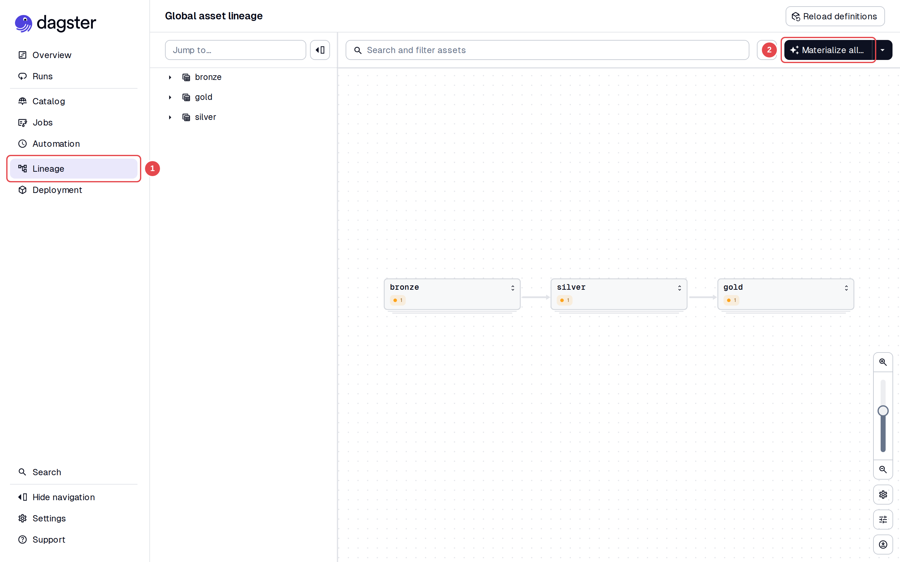

Pour voir les assets, cliquer sur la roue dentée en bas à droite du graphe, puis sur **Expand all groups** ①.

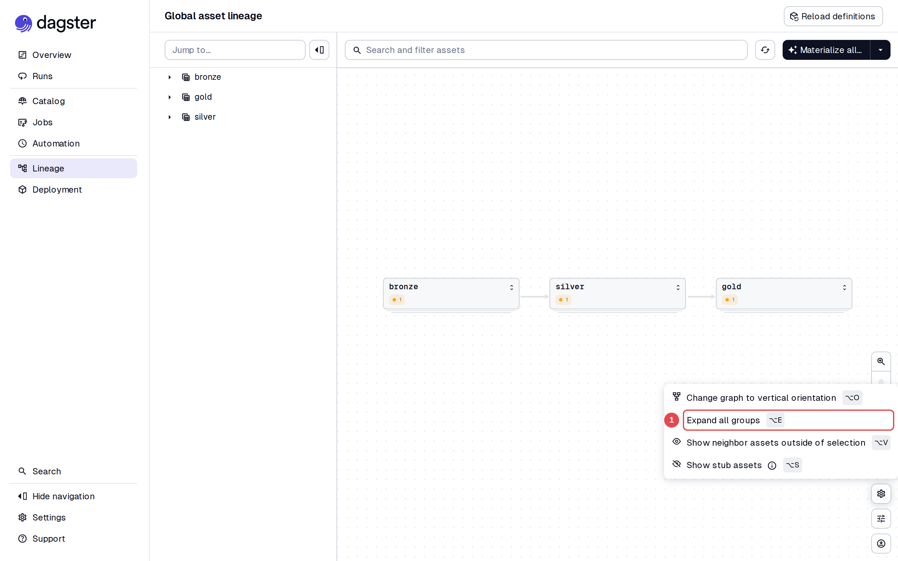


De près, chaque carte résume l'état d'un asset :


**Ce qu'il faut remarquer :**

- Les flèches se déduisent du code : `clean_tracks` dépend de `raw_tracks_data` parce que la fonction prend ce paramètre.
- **`0% filled`** : aucune des partitions n'est encore produite. Il y en a une par jour depuis le 2024-01-01.
- **`0 / 1 Passed`** sur `clean_tracks` : un check existe, mais il n'a jamais tourné.

**Cliquer sur** `clean_tracks`, puis sur l'onglet **Checks** ①. Le check ② est affiché **Not Evaluated**, et la page indique *This is a blocking asset check*.


---

## 3. Matérialiser depuis l'interface

Matérialiser signifie exécuter le code qui produit un asset et enregistrer le résultat. L'opération porte ici sur une seule journée.

1. Retourner sur **Lineage** et cliquer sur **Materialize all…**.
2. Cliquer sur **Show all partitions** ①. La fenêtre ne propose d'abord que les 90 derniers jours ; sans ce clic, une date de 2024 donne l'erreur `Could not find partition`.

   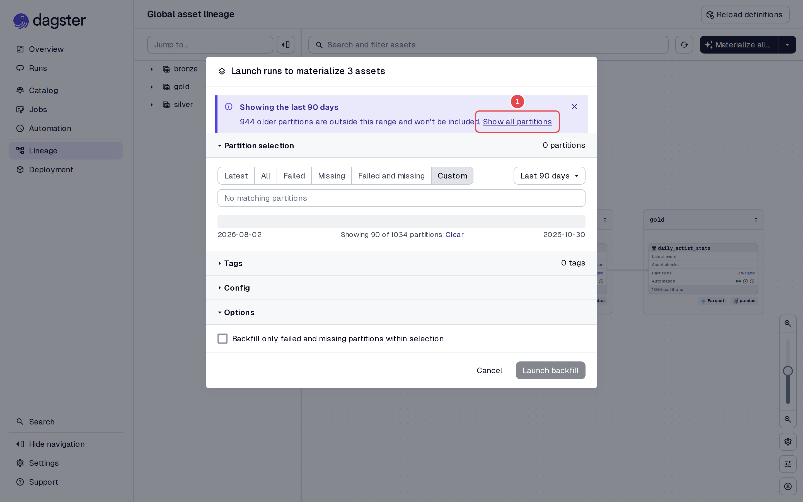

3. Cliquer sur **Custom** ①.
4. Saisir `2024-01-15` ② et appuyer sur Entrée. Le compteur passe à `1 partition`.
5. Cliquer sur **Launch 1 run** ③.


Ouvrir le menu **Runs** et cliquer sur l'identifiant du run. Après 15 à 20 secondes, le résultat est le suivant :


**Ce qu'il faut remarquer :**

- Le statut passe à **Success** ①, et le journal se termine par `RUN_SUCCESS` ②.
- La frise montre quatre étapes, dans l'ordre des dépendances : Bronze, Silver, le check, puis Gold.
- Chaque ligne du journal indique ce qui s'est passé, y compris le chemin du fichier écrit.

**Dans le terminal 2,** vérifier sur le disque :

```bash
find data -name '2024-01-15*' | sort
```

```text
data/clean_tracks/2024-01-15.parquet
data/daily_artist_stats/2024-01-15.parquet
data/raw_tracks_data/2024-01-15.parquet
```

Un seul clic a produit trois fichiers, un par asset. C'est le travail de l'IO Manager : le code renvoie un DataFrame, et celui-ci décide où et comment l'écrire.

---

## 4. Matérialiser en ligne de commande

Répéter maintenant l'opération pour le lendemain, sans toucher au navigateur. **Dans le terminal 2 :**

```bash
uv run dg launch --assets '*' --partition 2024-01-16
```

La sortie est longue. Lignes qui comptent, simplifiées :

```text
RUN_START - Started execution of run for "__ASSET_JOB".
raw_tracks_data - ASSET_MATERIALIZATION - Materialized value raw_tracks_data.
raw_tracks_data - STEP_SUCCESS - Finished execution of step "raw_tracks_data"
clean_tracks - ASSET_MATERIALIZATION - Materialized value clean_tracks.
clean_tracks - STEP_SUCCESS - Finished execution of step "clean_tracks"
clean_tracks_clean_tracks_id_not_null - ASSET_CHECK_EVALUATION - Asset check 'clean_tracks_id_not_null'...
daily_artist_stats - ASSET_MATERIALIZATION - Materialized value daily_artist_stats.
daily_artist_stats - STEP_SUCCESS - Finished execution of step "daily_artist_stats"
RUN_SUCCESS - Finished execution of run for "__ASSET_JOB".
```

**Dans le navigateur,** ouvrir **Runs**. La commande y figure ① à côté du run lancé depuis l'interface ②.


**Ce qu'il faut remarquer :** les deux lignes ont la même forme, car les deux chemins aboutissent au même résultat. Une commande et un clic ne sont que deux façons de piloter la même instance.

---

## 5. Lire les résultats

### Les partitions

**Cliquer sur** **Catalog**, puis `daily_artist_stats`, puis l'onglet **Partitions**, et sélectionner `2024-01-16`.


Le compteur affiche `Materialized (2)` ① : les journées lancées aux étapes 3 et 4. **View all historical events** ② donne l'historique de la partition.

### Les métadonnées

**Cliquer sur** l'onglet **Events**. Chaque matérialisation porte un aperçu ①, le chemin du fichier ②, le nombre de lignes ③ et le schéma des colonnes ④. Le résultat se lit donc sans ouvrir le Parquet.


**Cliquer sur** l'onglet **Overview**. Dagster reconnaît les métadonnées dont le nom commence par `dagster/` : il en tire le nombre de lignes ① et le tableau des colonnes ②. Les propriétaires ③ et les types ④ viennent de la déclaration de l'asset.

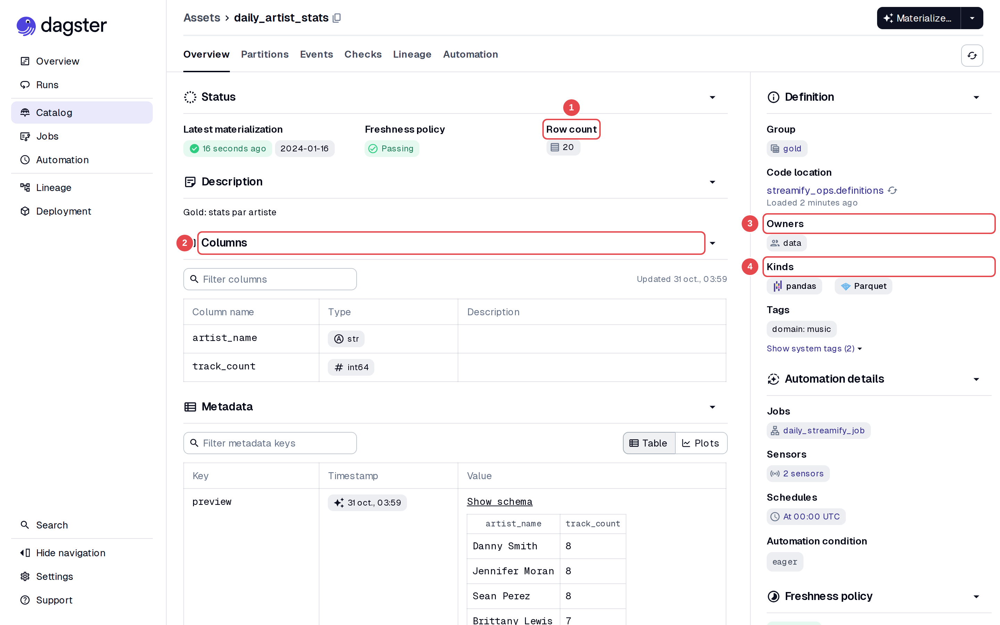

Vérifier que ce tableau correspond bien au fichier. **Dans le terminal 2 :**

```bash
uv run python -c "import pandas as pd; print(pd.read_parquet('data/daily_artist_stats/2024-01-16.parquet').head(5).to_string(index=False))"
```

```text
   artist_name  track_count
   Danny Smith            8
Jennifer Moran            8
    Sean Perez            8
Brittany Lewis            7
  Sarah Flores            7
```

Les données sont simulées à partir de la date : les valeurs obtenues sont exactement identiques.

### Le check

**Cliquer sur** **Catalog**, `clean_tracks`, onglet **Checks**. Le résultat est passé à **Passed** ①, avec `null_count = 0`.


---

## 6. Rattraper 30 jours avec un backfill

Un backfill produit de nombreuses partitions d'un coup, par exemple après une panne ou à l'ajout d'un nouvel asset.

1. Sur **Lineage**, cliquer sur **Materialize all…**, **Show all partitions**, puis **Custom**.
2. Saisir `[2024-02-01...2024-03-01]` ① et appuyer sur Entrée. Le compteur indique `30 partitions`.
3. Le bouton devient **Launch backfill** ② : cliquer dessus.


**Ouvrir** **Runs**, onglet **Backfills**, puis le backfill qui vient d'apparaître. Sa progression se met à jour au fil de l'exécution :


**Ce qu'il faut remarquer :** l'avancement respecte les dépendances. `daily_artist_stats` est toujours derrière `raw_tracks_data`. Le tout a pris 2 à 3 minutes sur la machine de test, chaque journée lançant son propre run.


**Revenir sur** **Catalog**, `daily_artist_stats`, **Partitions**. Le bloc vert correspond au mois rattrapé, et le compteur atteint `Materialized (32)` ①.


**Dans le terminal 2 :**

```bash
ls data/daily_artist_stats | wc -l
```

```text
32
```

Les 32 partitions de l'interface correspondent aux 32 fichiers sur le disque.

### Suivre un indicateur dans le temps

Dagster trace toute métadonnée numérique. **Ouvrir** **Catalog**, `clean_tracks`, onglet **Overview**, puis cliquer sur **Plots** ② et **Events** ① dans la section **Metadata**. La courbe `dagster/row_count` montre le nombre de lignes conservées à chaque matérialisation : une chute brutale y signalerait un problème de source.


---

## 7. Provoquer un problème de qualité

Le check n'a aucune raison d'échouer sur des données saines. Le projet permet donc d'injecter des `track_id` vides avec la config `null_track_ids`.

**Dans le terminal 2 :**

```bash
uv run dg launch --assets '*' --partition 2024-03-15 --config-json '{"ops":{"raw_tracks_data":{"config":{"null_track_ids":3}}}}'
```

La commande se termine par une erreur (code de sortie 1). Voici les lignes clés :

```text
clean_tracks_clean_tracks_id_not_null - ASSET_CHECK_EVALUATION - Asset check 'clean_tracks_id_not_null' on 'clean_tracks' did not pass.
clean_tracks_clean_tracks_id_not_null - STEP_FAILURE - Execution of step "clean_tracks_clean_tracks_id_not_null" failed.
daily_artist_stats - Dependencies for step daily_artist_stats failed: ['clean_tracks_clean_tracks_id_not_null']. Not executing.
RUN_FAILURE - Execution of run for "__ASSET_JOB" failed. Steps failed: ['clean_tracks_clean_tracks_id_not_null'].
dagster._core.errors.DagsterAssetCheckFailedError: 1 blocking asset check failed with ERROR severity:
```

### Le run dans l'interface

**Ouvrir** **Runs**, puis le dernier run. Il est en **Failure** ①, et le journal explique que Gold n'a pas été exécuté ②.


### Le check

**Ouvrir** **Catalog**, `clean_tracks`, **Checks**. Il indique **Failed** ① avec `null_count = 3` ②, le champ **Partition** donne `2024-03-15` ③, et la courbe remonte.


### Ce qui a été écrit, ou non

Dans **Partitions**, sélectionner `2024-03-15` sur chacun des deux assets.

Sur `clean_tracks`, la partition est **Materialized** ① :


Sur `daily_artist_stats`, le message indique que le run a échoué sans produire cet asset ①, et le compteur affiche `Failed (1)` ② :


**Vérifier sur le disque :**

```bash
find data -name '2024-03-15*' | sort
```

```text
data/clean_tracks/2024-03-15.parquet
data/raw_tracks_data/2024-03-15.parquet
```

```bash
uv run python -c "import pandas as pd; df = pd.read_parquet('data/clean_tracks/2024-03-15.parquet'); print('lignes', len(df), '- track_id vides', df.track_id.isna().sum())"
```

```text
lignes 94 - track_id vides 3
```

> **À retenir :** un check bloquant protège ce qui vient **après**, pas l'asset qu'il contrôle. Il s'exécute une fois `clean_tracks` écrit : les données fautives restent donc sur le disque jusqu'à la prochaine exécution.

### La même chose depuis l'interface

La config peut aussi être fournie dans la fenêtre de lancement :

1. Sur **Lineage**, cliquer sur **Materialize all…**, **Show all partitions**, **Custom**, et saisir `2024-03-20`.
2. Déplier **Config**, puis cliquer sur **Add config**.
3. Coller le texte ci-dessous, puis cliquer sur **Save config** ①.
4. Cliquer sur **Launch 1 run**.

```yaml
ops:
  raw_tracks_data:
    config:
      null_track_ids: 3
```


### Réparer

Relancer d'abord le 15 mars, sans config. Le fichier est remplacé et Gold est enfin produit :

```bash
uv run dg launch --assets '*' --partition 2024-03-15
```

Le check est évalué par date. Ouvrir son onglet **Partitions** ①, saisir `2024-03-20` dans le filtre, puis cliquer sur cette date. Elle reste **Failed** ②, avec `null_count = 3` ③ :

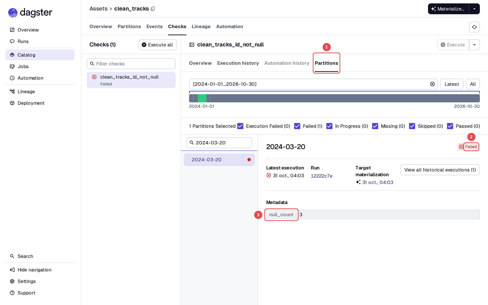

Le relancer à son tour :

```bash
uv run dg launch --assets '*' --partition 2024-03-20
```

Le check repasse à **Passed** ①, et sa courbe redescend à 0 :


> **Bon à savoir :** le bouton **Execute** est désactivé sur ce check : pour le rejouer, relancer la partition. Dagster classe les checks partitionnés en *preview*, pas encore considérés comme prêts pour la production.

---

## 8. Activer le schedule

Le schedule lance `daily_streamify_job` chaque jour à 00:00 UTC, sur la partition de la veille. Il est arrêté par défaut.

**Dans le navigateur,** ouvrir **Automation**, déplier `streamify_ops.definitions`, puis cliquer sur `daily_streamify_schedule`. L'interrupteur **Running** ① est désactivé.


**Dans le terminal 2,** interroger le même état. `dg` ne pilote pas les schedules : ces commandes passent encore par `dagster`, avec le module des définitions en paramètre. Parmi les lignes de log, la sortie contient :

```bash
uv run dagster schedule list -m streamify_ops.definitions
```

```text
Schedule: daily_streamify_schedule [STOPPED]
Cron Schedule: 0 0 * * *
```

Le démarrer :

```bash
uv run dagster schedule start -m streamify_ops.definitions daily_streamify_schedule
```

```text
Started schedule daily_streamify_schedule
```

**Recharger la page.** L'interrupteur est activé ① et une ligne **Next tick** indique le prochain déclenchement.


Pour voir ce qu'il ferait sans attendre minuit, cliquer sur **Preview tick result**, puis sur **Continue**. Dagster simule le déclenchement : une demande de run ① sur `daily_streamify_job` ②.


Cliquer sur **Close**. **Launch all & commit tick result** lancerait un vrai run.

Arrêter le schedule pour terminer :

```bash
uv run dagster schedule stop -m streamify_ops.definitions daily_streamify_schedule
```

> Un schedule ne se déclenche que si `dg dev` tourne à ce moment-là : c'est lui qui fait fonctionner le service d'arrière-plan chargé de surveiller l'heure.

---

## 9. Automatiser le pipeline

Jusqu'ici, tout était déclenché manuellement. Cette étape laisse Dagster agir seul :

| Objectif | Outil | Section |
|---|---|---|
| Recalculer la suite dès qu'un asset change | Declarative Automation, `eager()` | [9.1](#91-recalculer-quand-la-source-change) |
| Réagir à l'arrivée d'un fichier | Sensor | [9.2](#92-réagir-à-larrivée-dun-fichier) |
| Être prévenu d'un échec | Sensor d'échec de run | [9.3](#93-être-prévenu-dun-échec) |
| Survivre à une panne passagère | Retry | [9.4](#94-rejouer-après-une-panne-passagère) |
| Calculer sur une fenêtre de plusieurs jours | Dépendance entre partitions | [9.5](#95-dépendre-de-plusieurs-partitions) |
| Limiter les exécutions simultanées | File d'attente des runs | [9.6](#96-limiter-les-runs-simultanés) |
| Lancer à heure fixe, surveiller la fraîcheur | `on_cron()`, `FreshnessPolicy` | [9.7](#97-déclencher-à-heure-fixe-et-surveiller-la-fraîcheur) |

Ouvrir **Automation**. Tous les automatismes y figurent, arrêtés par défaut :

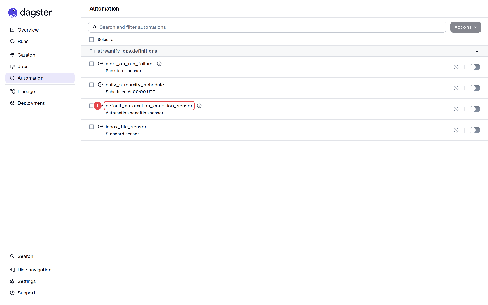

`default_automation_condition_sensor` ① ne vient pas du code du projet : Dagster le crée dès qu'un asset déclare une condition d'automatisation. C'est lui qui les évalue, toutes les 30 secondes environ.

### 9.1 Recalculer quand la source change

Silver et Gold déclarent `automation_condition=AutomationCondition.eager()` : ils se recalculent quand un asset en amont change. Pour une partition par jour, seule la dernière journée complète est concernée, c'est-à-dire la veille.

**Dans le terminal 2,** démarrer le sensor, attendre une minute pour qu'il fasse sa première évaluation, puis matérialiser **Bronze seul** sur la veille :

```bash
uv run dagster sensor start -m streamify_ops.definitions default_automation_condition_sensor
```

```bash
uv run dg launch --assets raw_tracks_data --partition "$(date -u -d yesterday +%F)"
```

**Dans le navigateur,** ouvrir **Runs**. Moins d'une minute plus tard, un second run apparaît. Le run manuel ① ne contient que Bronze ; celui du sensor ② enchaîne Silver, le check et Gold, sans action manuelle.

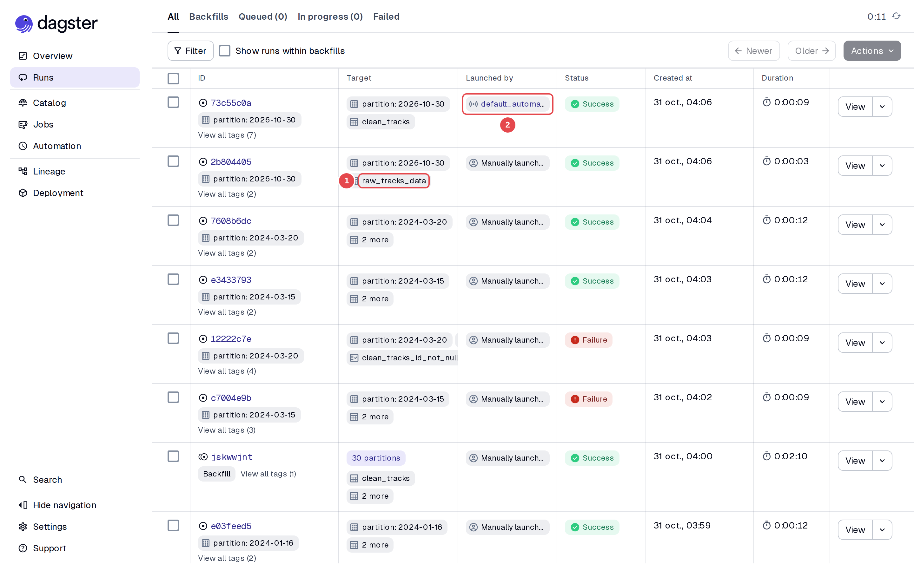

**Sur le disque,** les trois fichiers sont là, alors que seul le premier a été demandé :

```bash
find data -name "$(date -u -d yesterday +%F)*" | sort
```

Ouvrir **Catalog**, `clean_tracks`, onglet **Automation**. Chaque ligne est une évaluation. **1 requested** ① marque celle qui a lancé le run :

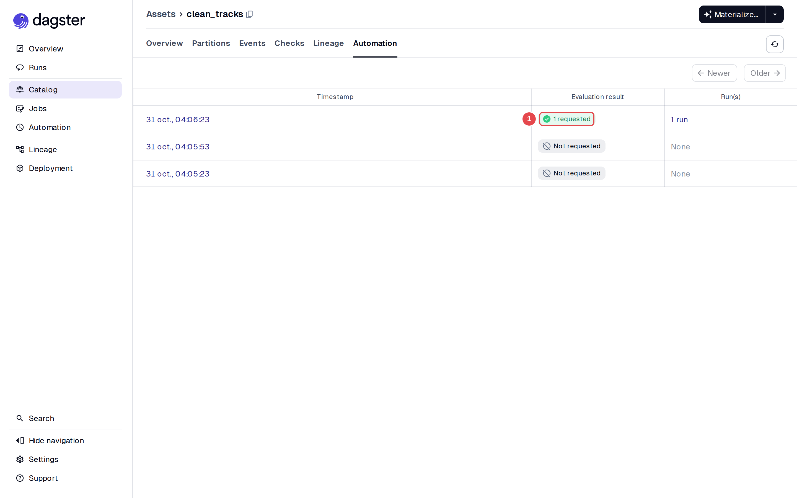

Le check bloquant fait partie de ce run automatique. Vérification faite en injectant l'anomalie sur Bronze : le run du sensor échoue au check et Gold n'est pas produit.

Arrêter le sensor :

```bash
uv run dagster sensor stop -m streamify_ops.definitions default_automation_condition_sensor
```

> **Une troisième condition, `on_missing()`,** lance une partition dès qu'elle devient disponible et que ses dépendances existent. Le projet ne l'utilise pas sur ses assets, mais [`test_automation.py`](tests/test_automation.py) la vérifie, en avançant le temps sans daemon grâce à `evaluate_automation_conditions`.

### 9.2 Réagir à l'arrivée d'un fichier

`inbox_file_sensor` regarde le dossier `data/inbox/` toutes les 10 secondes environ. Un fichier `AAAA-MM-JJ.ready` lance `daily_streamify_job` sur cette date. **Dans le terminal 2 :**

```bash
uv run dagster sensor start -m streamify_ops.definitions inbox_file_sensor
```

```bash
mkdir -p data/inbox
```

```bash
touch data/inbox/2024-04-10.ready
```

**Dans le navigateur,** ouvrir **Automation**, puis `inbox_file_sensor`. L'interrupteur est actif ①, et une évaluation a demandé un run ② :

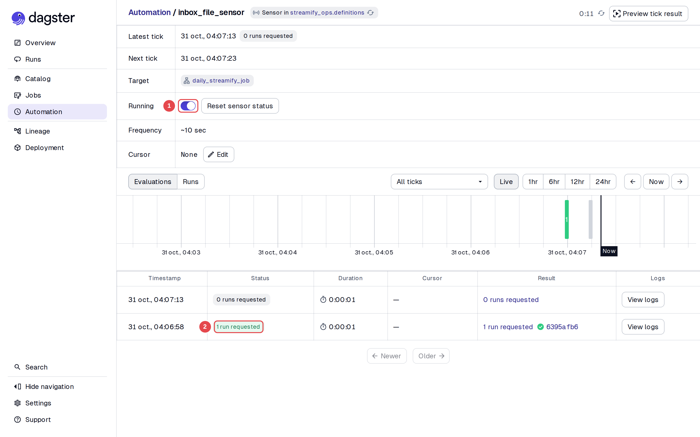

**Sur le disque :**

```bash
find data -name '2024-04-10*' | sort
```

```text
data/clean_tracks/2024-04-10.parquet
data/daily_artist_stats/2024-04-10.parquet
data/inbox/2024-04-10.ready
data/raw_tracks_data/2024-04-10.parquet
```

Le fichier reste dans `inbox/`, pourtant aucun second run ne part : le sensor donne à chaque run une clé (`run_key`), ici le nom du fichier, et Dagster ne lance jamais deux fois la même clé. Un nouveau `touch` sur ce fichier ne relance donc rien.

Arrêter le sensor et vider le dossier :

```bash
uv run dagster sensor stop -m streamify_ops.definitions inbox_file_sensor
```

```bash
rm -r data/inbox
```

### 9.3 Être prévenu d'un échec

`alert_on_run_failure` s'exécute après chaque run en échec. Ici, il écrit un fichier dans `data/alerts/` ; en production, il enverrait un message. **Dans le terminal 2,** le démarrer, attendre 30 secondes pour qu'il se positionne, puis provoquer un échec :

```bash
uv run dagster sensor start -m streamify_ops.definitions alert_on_run_failure
```

```bash
uv run dg launch --assets '*' --partition 2024-04-20 --config-json '{"ops":{"raw_tracks_data":{"config":{"null_track_ids":3}}}}'
```

La commande se termine par une erreur, comme à l'étape 7. Quelques secondes plus tard :

```bash
cat data/alerts/*.txt
```

```text
run=6a408c0f-a001-45de-ab01-40731a204d45
partition=2024-04-20
job=__ASSET_JOB
erreur=Execution of run for "__ASSET_JOB" failed. Steps failed: ['clean_tracks_clean_tracks_id_not_null'].
```

L'identifiant du run sera différent. **Dans le navigateur,** ouvrir **Automation**, puis `alert_on_run_failure`. L'interrupteur est actif ①, et la dernière évaluation renvoie au run en échec ② :

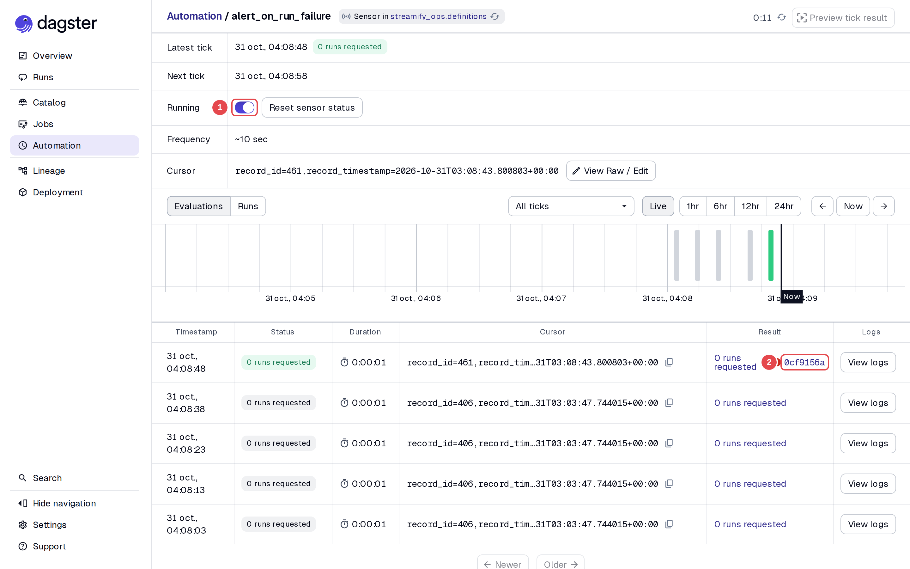

> Un sensor d'échec ne traite que les runs terminés **après** son démarrage : les échecs de l'étape 7 ne produisent aucune alerte.

L'arrêter, puis réparer la partition :

```bash
uv run dagster sensor stop -m streamify_ops.definitions alert_on_run_failure
```

```bash
uv run dg launch --assets '*' --partition 2024-04-20
```

### 9.4 Rejouer après une panne passagère

Bronze interroge une API, qui peut tomber un instant. Il déclare donc `retry_policy=RetryPolicy(max_retries=2, delay=5)` : deux nouvelles tentatives, à 5 secondes d'intervalle. La config `fail_attempts` simule la panne. **Dans le terminal 2 :**

```bash
uv run dg launch --assets raw_tracks_data --partition 2024-05-01 --config-json '{"ops":{"raw_tracks_data":{"config":{"fail_attempts":1}}}}'
```

La commande réussit. **Dans le navigateur,** ouvrir le run et saisir `step` dans le champ **Filter** du journal : l'étape échoue ①, repart cinq secondes plus tard ② et réussit ③.

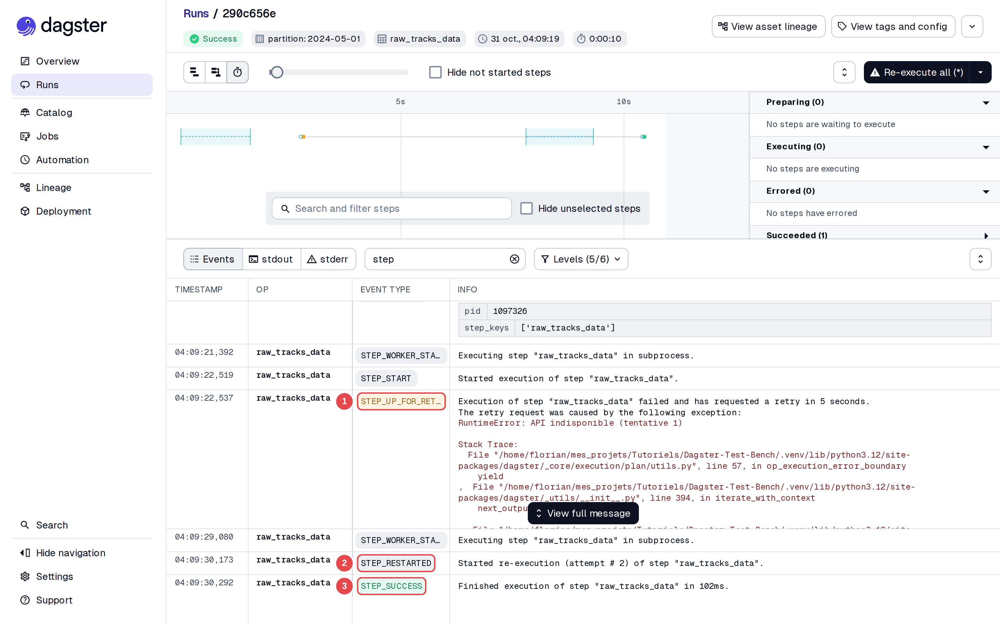

Avec `"fail_attempts":3` sur le 2 mai, les trois tentatives échouent et le run s'arrête en **Failure** : le retry absorbe une panne passagère, pas une panne durable.

### 9.5 Dépendre de plusieurs partitions

Jusqu'ici, chaque date ne lit que la même date en amont. `weekly_artist_stats` cumule au contraire **sept jours** de `daily_artist_stats`, grâce à `TimeWindowPartitionMapping(start_offset=-6)`.

Cet asset est livré à part, dans [`optional/`](src/streamify_ops/optional/weekly_artist_stats.py), pour garder le parcours principal à trois assets. Pour l'activer, il suffit de le placer dans `defs/` : Dagster charge tout ce que contient ce dossier. **Dans le terminal 2 :**

```bash
cp src/streamify_ops/optional/weekly_artist_stats.py src/streamify_ops/defs/assets/
```

**Dans le navigateur,** cliquer sur **Reload definitions** en haut à droite de **Lineage** : le quatrième asset apparaît. **Dans le terminal 2,** calculer le 20 février, dont les sept jours existent depuis le backfill :

```bash
uv run dg launch --assets weekly_artist_stats --partition 2024-02-20
```

Ouvrir **Catalog**, `weekly_artist_stats`, **Events**. La fenêtre lue va du 14 février ① au 20 février ② :

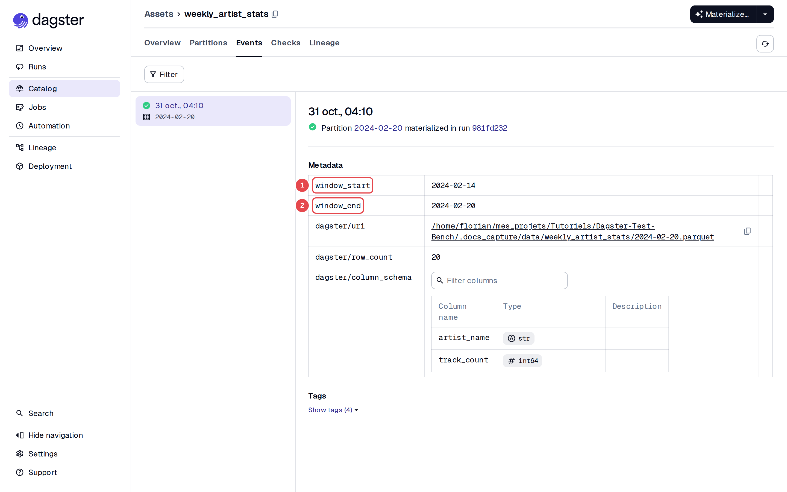

Comparer les fichiers :

```bash
uv run python -c "
import pandas as pd
days = pd.date_range('2024-02-14', '2024-02-20').strftime('%Y-%m-%d')
total = sum(pd.read_parquet(f'data/daily_artist_stats/{d}.parquet').track_count.sum() for d in days)
print('somme des 7 jours :', total)
print('cumul glissant    :', pd.read_parquet('data/weekly_artist_stats/2024-02-20.parquet').track_count.sum())
"
```

```text
somme des 7 jours : 643
cumul glissant    : 643
```

Un jour pas encore produit est simplement ignoré : la fenêtre de la métadonnée indique les dates demandées, pas les dates trouvées.

Retirer l'asset pour revenir au parcours principal, puis cliquer de nouveau sur **Reload definitions** :

```bash
rm src/streamify_ops/defs/assets/weekly_artist_stats.py
```

### 9.6 Limiter les runs simultanés

Par défaut, l'instance exécute 10 runs au plus en même temps. Cette limite se règle dans le fichier `dagster.yaml` de l'instance, lu au démarrage du serveur. Objectif : la ramener à 2.

**Dans le terminal 1,** arrêter le serveur avec `Ctrl+C`. Écrire la limite, puis relancer le serveur en activant au passage le mode accéléré qui servira en 9.7 :

```bash
printf 'concurrency:\n  runs:\n    max_concurrent_runs: 2\n' > "$DAGSTER_HOME/dagster.yaml"
```

```bash
export STREAMIFY_FAST_AUTOMATION=1
```

```bash
uv run dg dev
```

**Dans le terminal 2,** déposer six dates d'un coup :

```bash
uv run dagster sensor start -m streamify_ops.definitions inbox_file_sensor
```

```bash
mkdir -p data/inbox && touch data/inbox/2024-06-0{1,2,3,4,5,6}.ready
```

**Dans le navigateur,** ouvrir **Runs**. Les runs en trop attendent leur tour ①, et deux au plus s'exécutent ② :

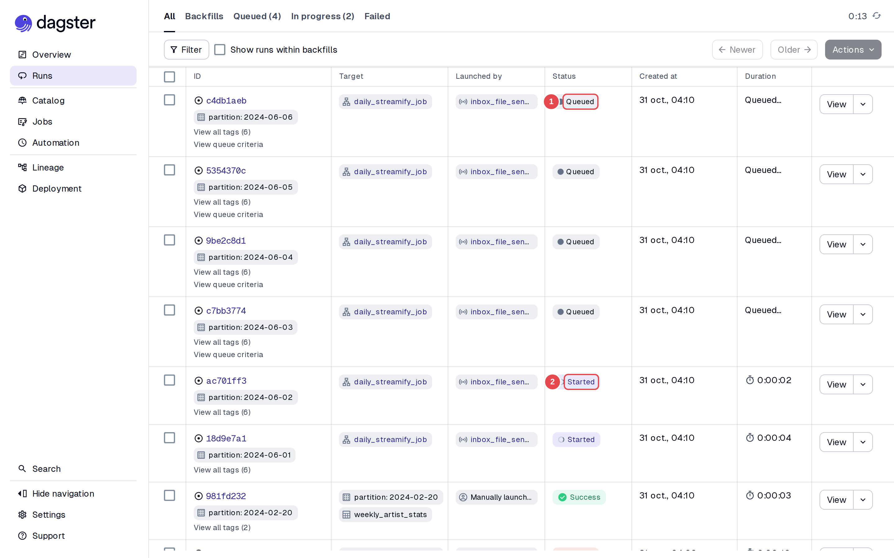

Quand les six runs sont terminés, nettoyer :

```bash
uv run dagster sensor stop -m streamify_ops.definitions inbox_file_sensor
```

```bash
rm -r data/inbox "$DAGSTER_HOME/dagster.yaml"
```

> `dagster.yaml` n'est relu qu'au démarrage : la limite reste active jusqu'au prochain redémarrage du serveur. Les commandes `dg launch` passent à côté de cette file : elles exécutent le run directement dans le terminal.

### 9.7 Déclencher à heure fixe et surveiller la fraîcheur

Deux réglages du projet dépendent du temps :

| Déclaré sur | Réglage | Valeur normale | En mode accéléré |
|---|---|---|---|
| `raw_tracks_data` | `AutomationCondition.on_cron(...)` | 01:00 UTC chaque jour | Chaque minute |
| `daily_artist_stats` | `FreshnessPolicy.time_window(...)` | Alerte après 26 h, échec après 48 h | Alerte après 2 min, échec après 4 min |

`STREAMIFY_FAST_AUTOMATION=1`, activé en 9.6, sert uniquement à les observer sans attendre. **Dans le terminal 2,** redémarrer le sensor d'automatisation :

```bash
uv run dagster sensor start -m streamify_ops.definitions default_automation_condition_sensor
```

Ouvrir **Runs**. En une à deux minutes, sans aucune commande manuelle, le sensor ① lance un run sur la dernière partition : le cron relance Bronze, puis Silver et Gold suivent. Selon l'évaluation, le tout tient dans un seul run ou se répartit sur deux runs successifs ; les deux cas ont été observés.

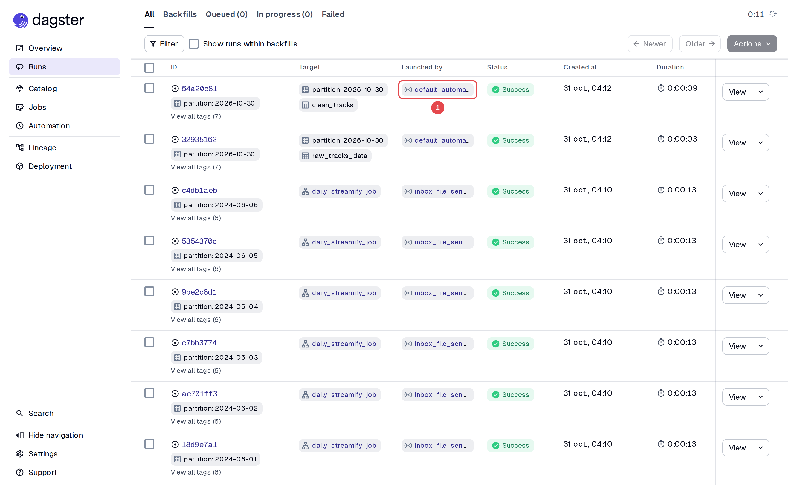

Arrêter le sensor, puis ouvrir **Catalog**, `daily_artist_stats`, **Overview**. Gold vient d'être produit : sa politique de fraîcheur est **Passing** ①.

```bash
uv run dagster sensor stop -m streamify_ops.definitions default_automation_condition_sensor
```

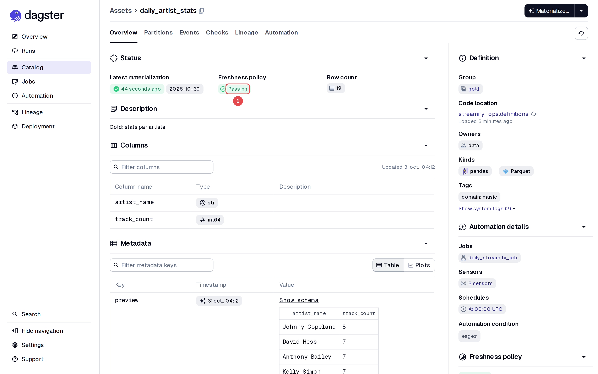

Plus rien ne met Gold à jour. Après quelques minutes, le statut passe à **Warning** ①, puis à **Failed** ① :

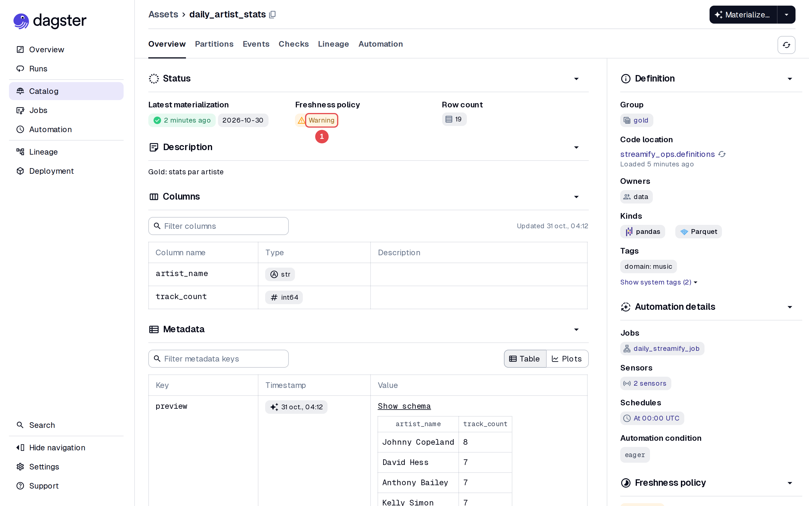

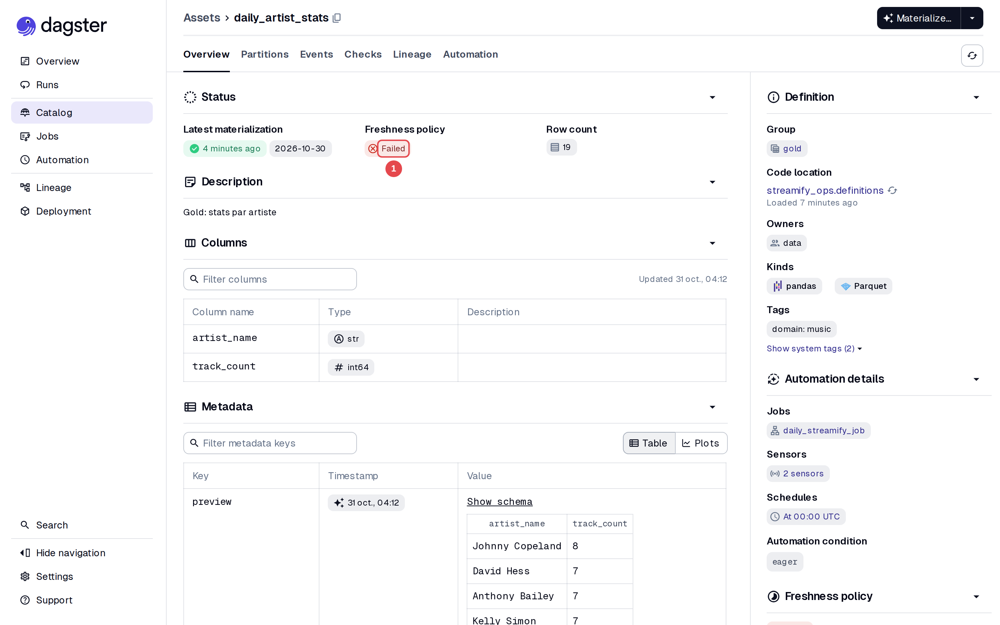

> **À éviter :** `daily_streamify_schedule` et `default_automation_condition_sensor` actifs en même temps. Le schedule traite la veille à 00:00 UTC, puis le cron la recalcule à 01:00 UTC. [`test_automation.py`](tests/test_automation.py) le montre en temps simulé. Choisir l'un ou l'autre.

Une politique de fraîcheur ne lance rien : elle signale. Pour y réagir automatiquement, la combiner avec une condition d'automatisation ou un sensor.

**Pour quitter le mode accéléré,** dans le terminal 1 : `Ctrl+C`, puis :

```bash
unset STREAMIFY_FAST_AUTOMATION
```

```bash
uv run dg dev
```

---

## 10. Publier dans PostgreSQL

Les fichiers Parquet conviennent au pipeline, mais un outil de restitution lit plutôt une base de données. Cette étape publie Gold dans une table PostgreSQL. Elle montre aussi une **ressource** : un objet de connexion déclaré une seule fois, puis injecté dans les assets qui le demandent. Docker est nécessaire. La base écoute sur le port 5434, pour ne pas gêner une éventuelle installation existante.

### 10.1 Démarrer la base

**Dans le terminal 1,** arrêter le serveur avec `Ctrl+C`, définir le mot de passe, démarrer la base, puis relancer le serveur :

```bash
export STREAMIFY_PG_PASSWORD=streamify
```

```bash
docker compose up -d --wait
```

```bash
uv run dg dev
```

**Dans le terminal 2,** définir la même variable, puis activer l'export. Comme à l'étape 9.5, tout fichier placé dans `defs/` est chargé :

```bash
export STREAMIFY_PG_PASSWORD=streamify
```

```bash
cp src/streamify_ops/optional/artist_stats_table.py src/streamify_ops/defs/assets/
```

**Dans le navigateur,** cliquer sur **Reload definitions** en haut à droite de **Lineage**.

### 10.2 Écrire dans la table

**Dans le terminal 2 :**

```bash
uv run dg launch --assets artist_stats_table --partition 2024-02-20
```

**Dans la base :**

```bash
docker compose exec -T postgres psql -U streamify -c "SELECT * FROM artist_stats ORDER BY track_count DESC, artist_name LIMIT 3"
```

```text
 partition_date |  artist_name   | track_count 
----------------+----------------+-------------
 2024-02-20     | Jennifer Moran |           8
 2024-02-20     | Danny Smith    |           7
 2024-02-20     | James Rogers   |           6
(3 rows)
```

**Dans le navigateur,** ouvrir **Catalog**, puis `artist_stats_table`. Le nombre de lignes ① et le type **Postgres** ② viennent de l'asset :

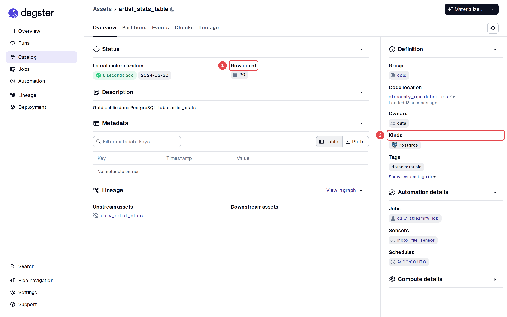

Le code reçoit la connexion en paramètre : `postgres: PostgresResource`. Le mot de passe n'y figure pas, seule `EnvVar("STREAMIFY_PG_PASSWORD")` y renvoie. La page de la ressource, accessible par **Deployment**, emplacement de code, **Definitions**, **Resources**, affiche le nom de la variable ① et non sa valeur :

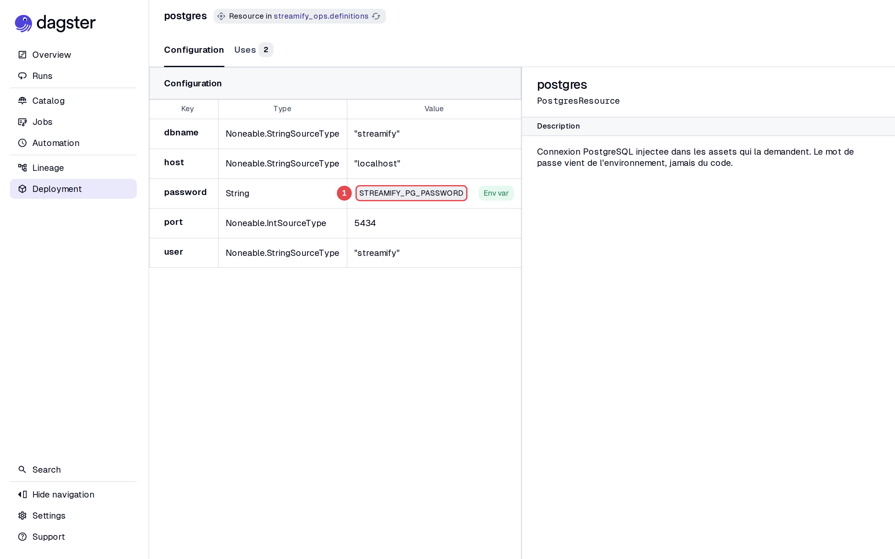

Relancer une date ne crée pas de doublon : l'asset remplace les lignes de la partition dans une seule transaction.

### 10.3 Reprendre après une panne

Une panne de la base ne doit pas obliger à tout recalculer. **Dans le terminal 2,** arrêter la base :

```bash
docker compose stop postgres
```

**Dans le navigateur,** sur **Lineage**, cliquer sur **Materialize all…**, **Show all partitions**, **Custom**, saisir `2024-08-01`, puis **Launch 1 run**.

Le run s'arrête en **Failure** ①. La ligne `RUN_FAILURE` ② indique `Steps failed: ['artist_stats_table']`, avec l'erreur `Connection refused` : Bronze, Silver, le check et Gold ont réussi.

**Dans le terminal 2,** redémarrer la base :

```bash
docker compose up -d --wait
```

**Dans le navigateur,** sur la page du run, ouvrir la flèche à droite de **Re-execute all (\*)**, puis cliquer sur **From failure** ③ :

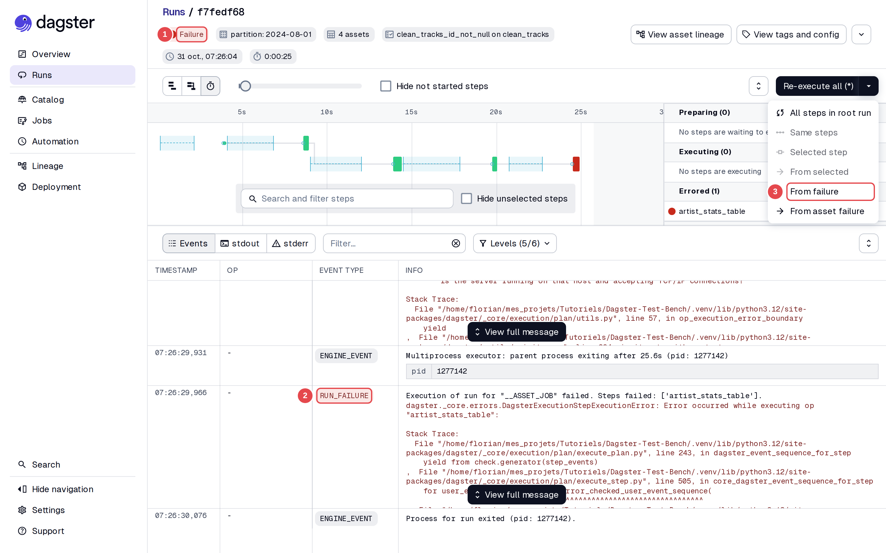

Un nouveau run démarre et se termine en **Success** ① ②. Le panneau **Re-executions** le rattache au run d'origine. Seule l'étape `artist_stats_table` s'exécute : Gold est relu depuis le fichier déjà écrit, sans repasser par les étapes précédentes.

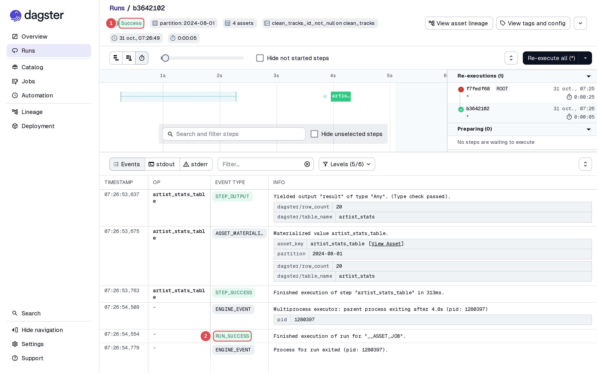

**Dans la base :**

```bash
docker compose exec -T postgres psql -U streamify -c "SELECT partition_date, count(*) FROM artist_stats GROUP BY partition_date ORDER BY partition_date"
```

```text
 partition_date | count 
----------------+-------
 2024-02-20     |    20
 2024-08-01     |    20
(2 rows)
```

> **Limite observée :** sur un run lancé par `dg launch`, **From failure** échoue avec `CheckError: Expected non-None value: None`. Ces runs ne portent pas d'emplacement de code d'origine. Pour pouvoir les relancer depuis l'interface, les lancer depuis l'interface.

Retirer l'asset, puis cliquer de nouveau sur **Reload definitions** :

```bash
rm src/streamify_ops/defs/assets/artist_stats_table.py
```

---

## 11. Lancer les tests

**Dans le terminal 2 :**

```bash
uv run pytest
```

```text
23 passed, 14 warnings
```

**Regarder maintenant l'interface :** aucun nouveau run, et aucun nouveau fichier dans `data/`. Les tests utilisent une instance temporaire, en mémoire ou dans un dossier jetable. Le pipeline peut donc être testé sans toucher à l'historique.

Sans `STREAMIFY_PG_PASSWORD`, les deux tests qui exigent une vraie base sont ignorés : `21 passed, 2 skipped`. Ces tests suppriment la table `artist_stats` de la base du tutoriel.

Ils vérifient aussi ce qui vient d'être observé : un échec du check bloque Gold, le schedule vise la veille, le retry reprend après une panne, les sensors réagissent, et les conditions d'automatisation se déclenchent au bon moment. Pour ces dernières, `evaluate_automation_conditions` simule l'écoulement du temps sans service d'arrière-plan.

---

## Pour finir

Arrêter le serveur avec `Ctrl+C` dans le terminal 1, puis supprimer la base et ses données :

```bash
docker compose down -v
```

L'historique reste dans `.dagster_home/` et les données dans `data/` : ils seront là au prochain lancement.

Pour explorer le code derrière les éléments observés :

| Élément observé | Le code est dans… |
|---|---|
| Les trois assets et leurs dépendances | [`defs/assets/`](src/streamify_ops/defs/assets/) |
| Le chargement automatique de `defs/` | [`definitions.py`](src/streamify_ops/definitions.py) |
| Le check bloquant | [`transformation.py`](src/streamify_ops/defs/assets/transformation.py) |
| L'anomalie `null_track_ids` et la panne `fail_attempts` | [`ingestion.py`](src/streamify_ops/defs/assets/ingestion.py) |
| L'aperçu en tableau et la politique de fraîcheur | [`analytics.py`](src/streamify_ops/defs/assets/analytics.py) |
| Les fichiers Parquet de `data/` et les métadonnées standard | [`local_filesystem_io_manager.py`](src/streamify_ops/resources/local_filesystem_io_manager.py) |
| Le déclenchement quotidien | [`schedules.py`](src/streamify_ops/defs/schedules.py) |
| Les sensors de fichier et d'échec | [`sensors.py`](src/streamify_ops/defs/sensors.py) |
| Le cumul sur 7 jours | [`weekly_artist_stats.py`](src/streamify_ops/optional/weekly_artist_stats.py) |
| Le mode accéléré | [`settings.py`](src/streamify_ops/settings.py) |
| La connexion à PostgreSQL | [`postgres.py`](src/streamify_ops/resources/postgres.py) |
| L'export vers la table `artist_stats` | [`artist_stats_table.py`](src/streamify_ops/optional/artist_stats_table.py) |
| La base du tutoriel | [`docker-compose.yml`](docker-compose.yml) |
