# Tutoriel — Dagster par la pratique

Ce parcours relie, à chaque étape, **ce que vous lancez**, **ce que l'interface affiche** et **ce qui apparaît sur le disque**. Comptez environ 30 minutes. Pour la présentation du projet et les informations de référence, voir le [manuel utilisateur](documentation/manuel-utilisateur.md).

Vous aurez besoin de **deux terminaux** placés à la racine du projet, et d'un navigateur.

> Les captures viennent d'une exécution réelle de ce parcours sous Dagster 1.13.24. Trois différences sont normales chez vous : les dates d'exécution et les identifiants de runs, le total de partitions qui augmente chaque jour, et les chemins, qui affichent `.docs_capture/data/` sur les captures et `data/` chez vous.

**Le parcours :**

1. [Démarrer](#1-démarrer)
2. [Lire le graphe](#2-lire-le-graphe)
3. [Matérialiser depuis l'interface](#3-matérialiser-depuis-linterface)
4. [Matérialiser en ligne de commande](#4-matérialiser-en-ligne-de-commande)
5. [Lire les résultats](#5-lire-les-résultats)
6. [Rattraper 30 jours avec un backfill](#6-rattraper-30-jours-avec-un-backfill)
7. [Provoquer un problème de qualité](#7-provoquer-un-problème-de-qualité)
8. [Activer le schedule](#8-activer-le-schedule)
9. [Lancer les tests](#9-lancer-les-tests)

---

## 1. Démarrer

**Dans le terminal 1,** installez le projet :

```bash
uv sync --extra dev
```

Indiquez à Dagster où garder son historique, puis créez ce dossier :

```bash
export DAGSTER_HOME="$PWD/.dagster_home"
```

```bash
mkdir -p "$DAGSTER_HOME"
```

Lancez le serveur. Il reste actif et occupe ce terminal :

```bash
uv run dagster dev -m streamify_ops
```

Quand le terminal affiche `Serving dagster-webserver on http://127.0.0.1:3000`, ouvrez [http://localhost:3000](http://localhost:3000).

**Dans le navigateur,** une fenêtre d'accueil propose de rejoindre la communauté. Cliquez sur **Skip** ①.

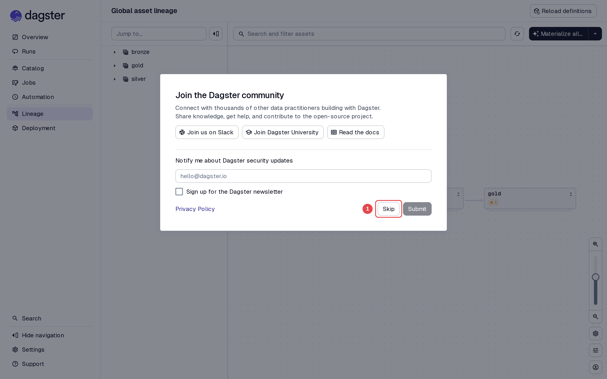

**Dans le terminal 2,** exportez la même variable. Vous l'utiliserez à l'étape 4 :

```bash
export DAGSTER_HOME="$PWD/.dagster_home"
```

> **Pourquoi cette variable ?** Elle relie vos commandes à l'interface. Nous avons testé sans : la commande réussit et écrit son fichier, mais l'interface affiche zéro run, car chacune utilise sa propre instance.

---

## 2. Lire le graphe

**Cliquez sur** **Lineage** ① dans le menu de gauche. La page montre les trois assets du pipeline. **Materialize all…** ② servira à l'étape suivante.

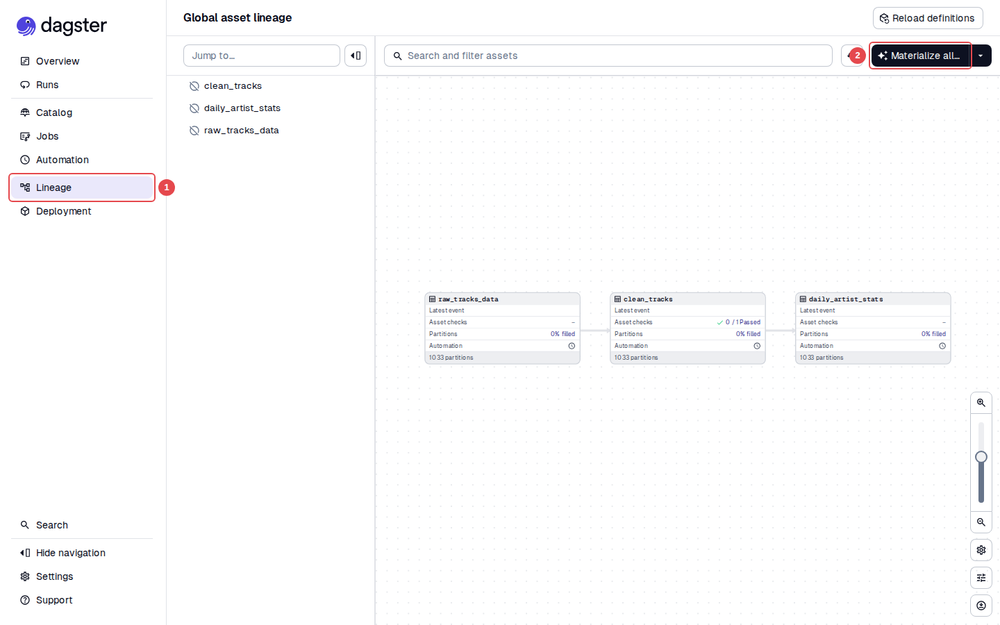

De près, chaque carte résume l'état d'un asset :

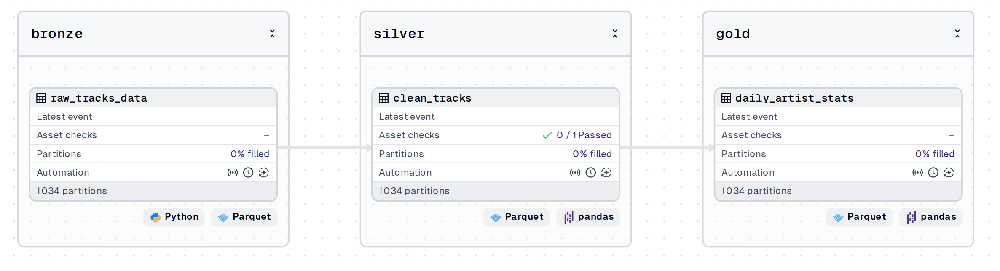

**Ce qu'il faut remarquer :**

- Les flèches se déduisent du code : `clean_tracks` dépend de `raw_tracks_data` parce que la fonction prend ce paramètre.
- **`0% filled`** : aucune des partitions n'est encore produite. Il y en a une par jour depuis le 2024-01-01.
- **`0 / 1 Passed`** sur `clean_tracks` : un check existe, mais il n'a jamais tourné.

**Cliquez sur** `clean_tracks`, puis sur l'onglet **Checks** ①. Le check ② est affiché **Not Evaluated**, et la page indique *This is a blocking asset check*.

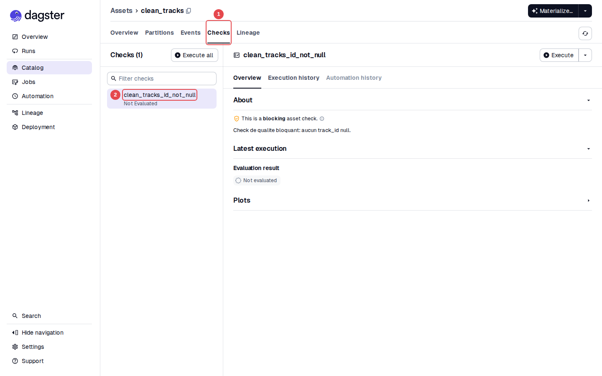

---

## 3. Matérialiser depuis l'interface

Matérialiser signifie exécuter le code qui produit un asset et enregistrer le résultat. Vous allez le faire pour une seule journée.

1. Retournez sur **Lineage** et cliquez sur **Materialize all…**.
2. Cliquez sur **Custom** ①.
3. Saisissez `2024-01-15` ② et appuyez sur Entrée. Le compteur passe à `1 partition`.
4. Cliquez sur **Launch 1 run** ③.

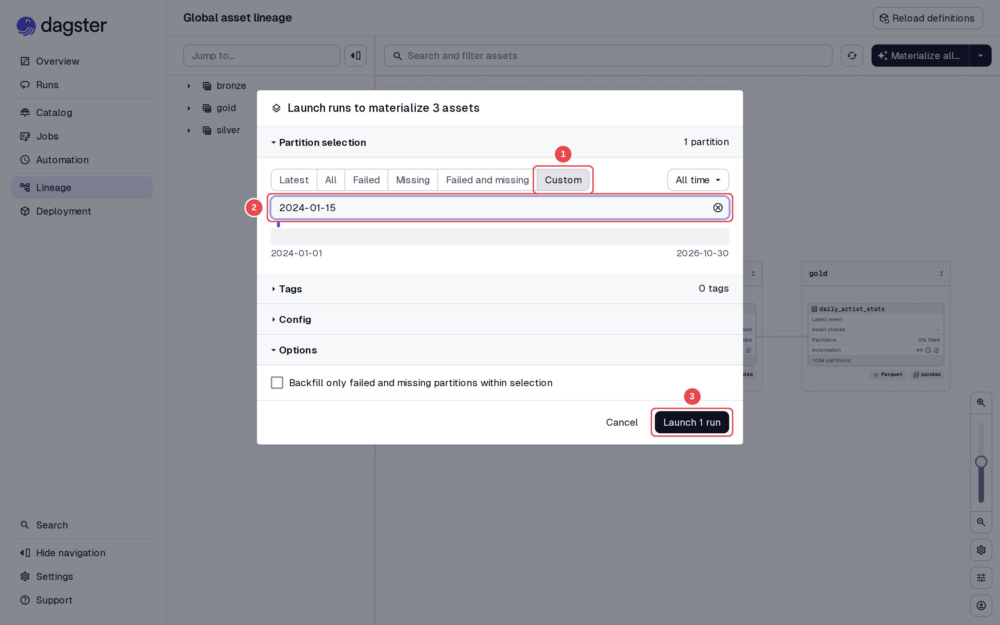

Ouvrez le menu **Runs** et cliquez sur l'identifiant du run. Après 15 à 20 secondes, vous obtenez ceci :

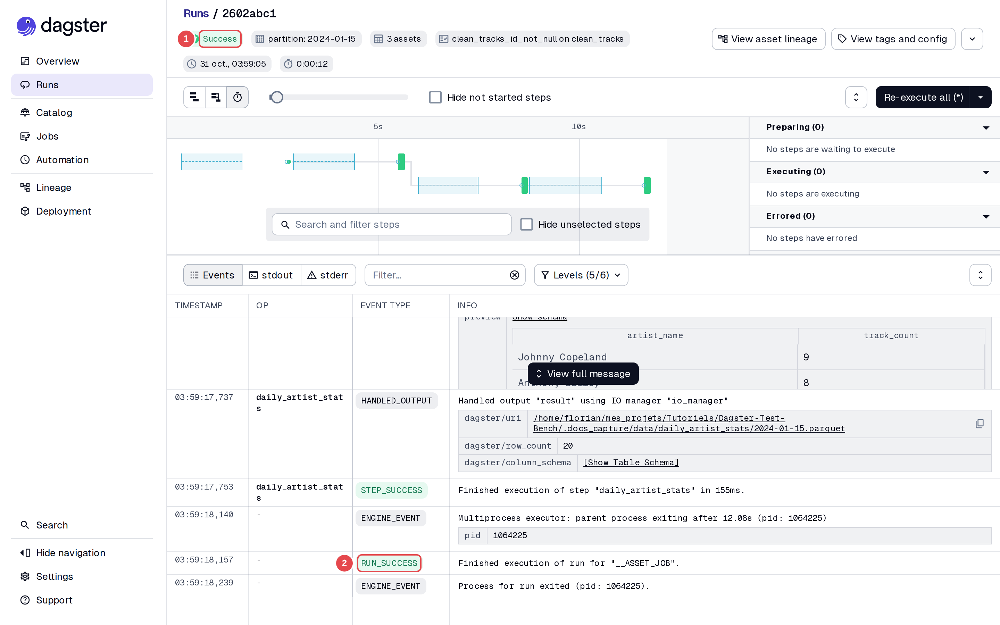

**Ce qu'il faut remarquer :**

- Le statut passe à **Success** ①, et le journal se termine par `RUN_SUCCESS` ②.
- La frise montre quatre étapes, dans l'ordre des dépendances : Bronze, Silver, le check, puis Gold.
- Chaque ligne du journal indique ce qui s'est passé, y compris le chemin du fichier écrit.

**Dans le terminal 2,** vérifiez sur le disque :

```bash
find data -name '2024-01-15*' | sort
```

```text
data/clean_tracks/2024-01-15.parquet
data/daily_artist_stats/2024-01-15.parquet
data/raw_tracks_data/2024-01-15.parquet
```

Un seul clic a produit trois fichiers, un par asset. C'est le travail de l'IO Manager : le code renvoie un DataFrame, et celui-ci décide où et comment l'écrire.

---

## 4. Matérialiser en ligne de commande

Faites maintenant la même chose pour le lendemain, sans toucher au navigateur. **Dans le terminal 2 :**

```bash
uv run dagster asset materialize -m streamify_ops --select '*' --partition 2024-01-16
```

La sortie est longue. Voici les lignes qui comptent, simplifiées :

```text
RUN_START - Started execution of run for "__ASSET_JOB".
raw_tracks_data - ASSET_MATERIALIZATION - Materialized value raw_tracks_data.
raw_tracks_data - STEP_SUCCESS - Finished execution of step "raw_tracks_data"
clean_tracks - ASSET_MATERIALIZATION - Materialized value clean_tracks.
clean_tracks - STEP_SUCCESS - Finished execution of step "clean_tracks"
clean_tracks_clean_tracks_id_not_null - ASSET_CHECK_EVALUATION - Asset check 'clean_tracks_id_not_null'...
daily_artist_stats - ASSET_MATERIALIZATION - Materialized value daily_artist_stats.
daily_artist_stats - STEP_SUCCESS - Finished execution of step "daily_artist_stats"
RUN_SUCCESS - Finished execution of run for "__ASSET_JOB".
```

**Dans le navigateur,** ouvrez **Runs**. Votre commande y figure ① à côté du run lancé depuis l'interface ②.

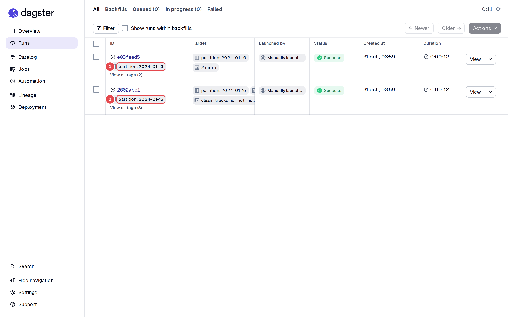

**Ce qu'il faut remarquer :** les deux lignes ont la même forme, car les deux chemins aboutissent au même résultat. Une commande et un clic ne sont que deux façons de piloter la même instance.

---

## 5. Lire les résultats

### Les partitions

**Cliquez sur** **Catalog**, puis `daily_artist_stats`, puis l'onglet **Partitions**, et sélectionnez `2024-01-16`.

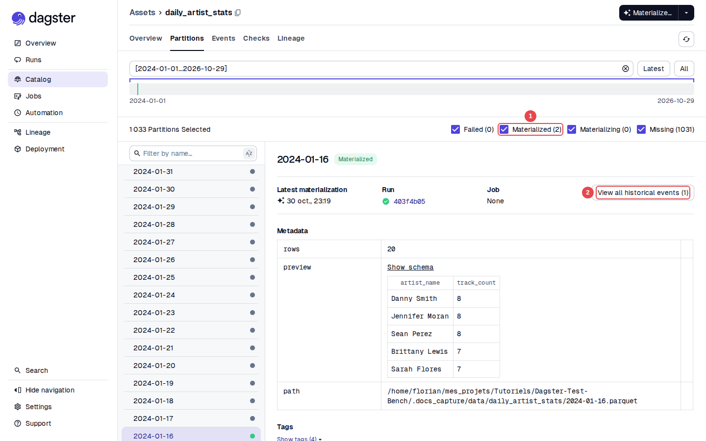

Le compteur affiche `Materialized (2)` ① : les journées lancées aux étapes 3 et 4. **View all historical events** ② donne l'historique de la partition.

### Les métadonnées

**Cliquez sur** l'onglet **Events**. Le code a joint à chaque matérialisation un aperçu ① et le chemin du fichier ②. Vous lisez donc le résultat sans ouvrir le Parquet.

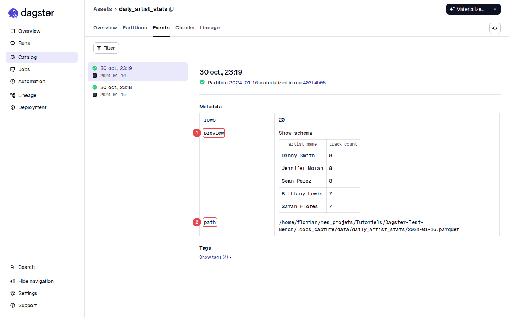

Vérifiez que ce tableau correspond bien au fichier. **Dans le terminal 2 :**

```bash
uv run python -c "import pandas as pd; print(pd.read_parquet('data/daily_artist_stats/2024-01-16.parquet').head(5).to_string(index=False))"
```

```text
   artist_name  track_count
   Danny Smith            8
Jennifer Moran            8
    Sean Perez            8
Brittany Lewis            7
  Sarah Flores            7
```

Les données sont simulées à partir de la date : vous devriez obtenir exactement les mêmes valeurs.

### Le check

**Cliquez sur** **Catalog**, `clean_tracks`, onglet **Checks**. Le résultat est passé à **Passed** ①, avec `null_count = 0`.

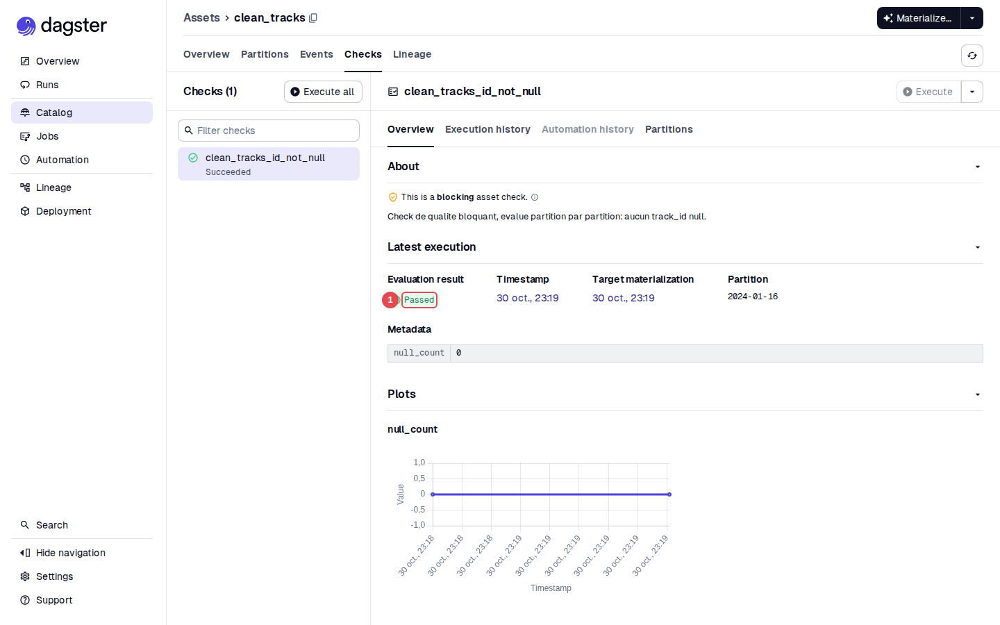

---

## 6. Rattraper 30 jours avec un backfill

Un backfill produit de nombreuses partitions d'un coup, par exemple après une panne ou à l'ajout d'un nouvel asset.

1. Sur **Lineage**, cliquez sur **Materialize all…**, puis sur **Custom**.
2. Saisissez `[2024-02-01...2024-03-01]` ① et appuyez sur Entrée. Le compteur indique `30 partitions`.
3. Le bouton devient **Launch backfill** ② : cliquez dessus.

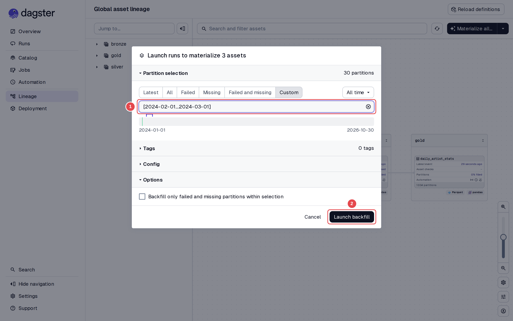

**Ouvrez** **Runs**, onglet **Backfills**, puis le backfill qui vient d'apparaître. Sa progression se met à jour au fil de l'exécution :

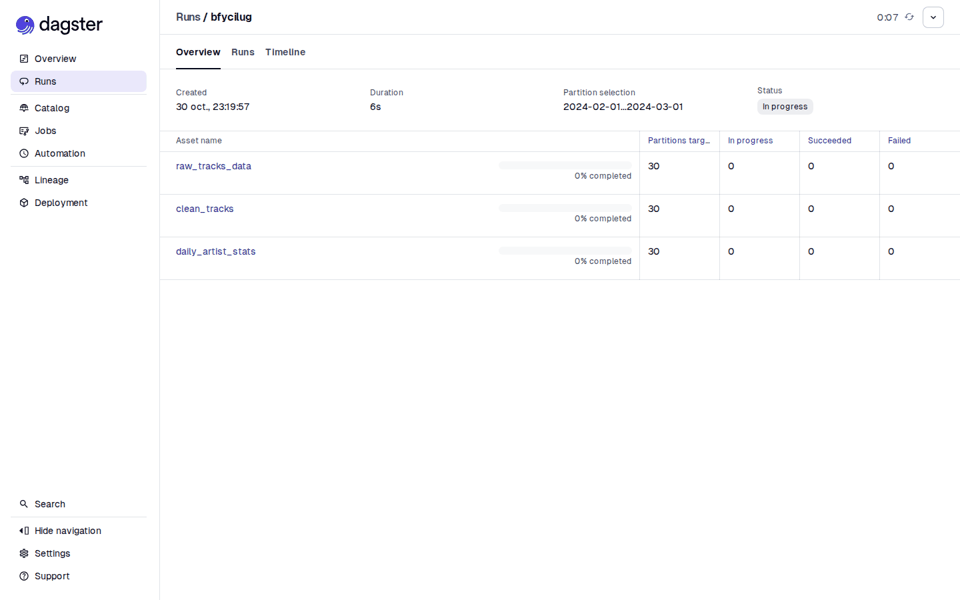

**Ce qu'il faut remarquer :** l'avancement respecte les dépendances. `daily_artist_stats` est toujours derrière `raw_tracks_data`. Le tout a pris environ 3 minutes sur la machine de test, chaque journée lançant son propre run.

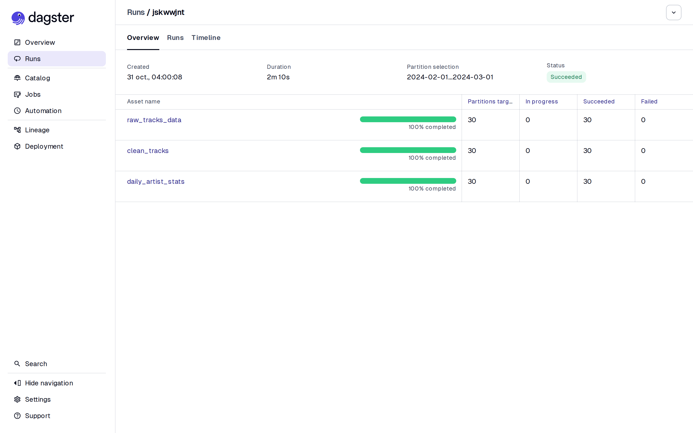

**Revenez sur** **Catalog**, `daily_artist_stats`, **Partitions**. Le bloc vert correspond au mois rattrapé, et le compteur atteint `Materialized (32)` ①.

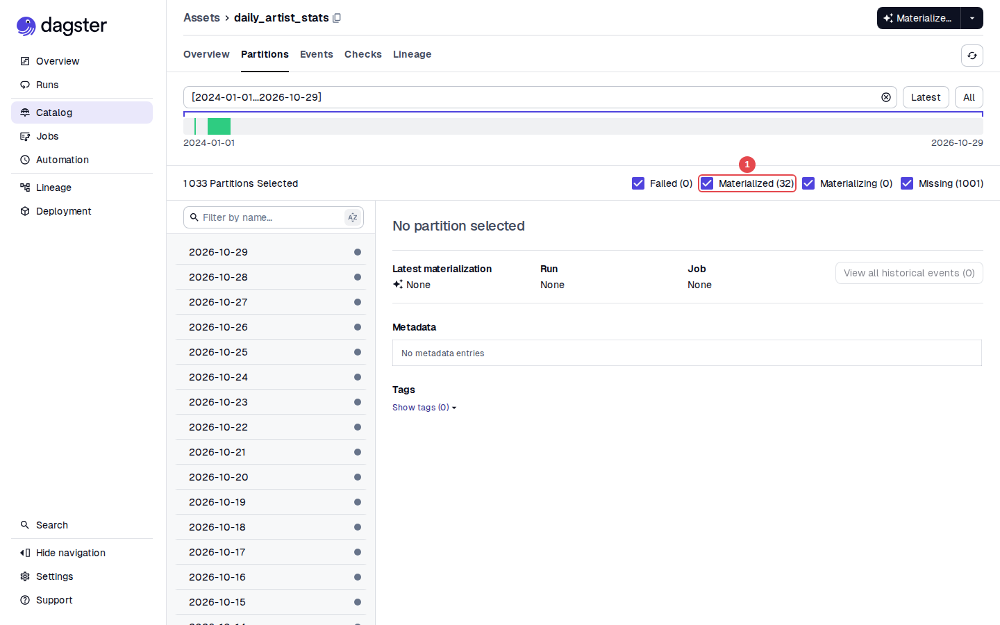

**Dans le terminal 2 :**

```bash
ls data/daily_artist_stats | wc -l
```

```text
32
```

Les 32 partitions de l'interface correspondent aux 32 fichiers sur le disque.

### Suivre un indicateur dans le temps

Dagster trace toute métadonnée numérique. **Ouvrez** **Catalog**, `clean_tracks`, onglet **Overview**, puis cliquez sur **Plots** ② et **Events** ① dans la section **Metadata**. La courbe `rows` montre le nombre de lignes conservées à chaque matérialisation : une chute brutale y signalerait un problème de source.

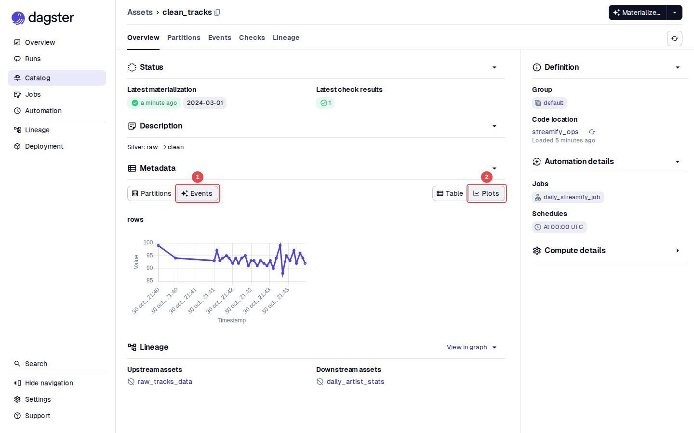

---

## 7. Provoquer un problème de qualité

Le check n'a aucune raison d'échouer sur des données saines. Le projet permet donc d'injecter des `track_id` vides avec la config `null_track_ids`.

**Dans le terminal 2 :**

```bash
uv run dagster asset materialize -m streamify_ops --select '*' --partition 2024-03-15 --config-json '{"ops":{"raw_tracks_data":{"config":{"null_track_ids":3}}}}'
```

La commande se termine par une erreur (code de sortie 1). Voici les lignes clés :

```text
clean_tracks_clean_tracks_id_not_null - ASSET_CHECK_EVALUATION - Asset check 'clean_tracks_id_not_null' on 'clean_tracks' did not pass.
clean_tracks_clean_tracks_id_not_null - STEP_FAILURE - Execution of step "clean_tracks_clean_tracks_id_not_null" failed.
daily_artist_stats - Dependencies for step daily_artist_stats failed: ['clean_tracks_clean_tracks_id_not_null']. Not executing.
RUN_FAILURE - Execution of run for "__ASSET_JOB" failed. Steps failed: ['clean_tracks_clean_tracks_id_not_null'].
dagster._core.errors.DagsterAssetCheckFailedError: 1 blocking asset check failed with ERROR severity:
```

### Le run dans l'interface

**Ouvrez** **Runs**, puis le dernier run. Il est en **Failure** ①, et le journal explique que Gold n'a pas été exécuté ②.

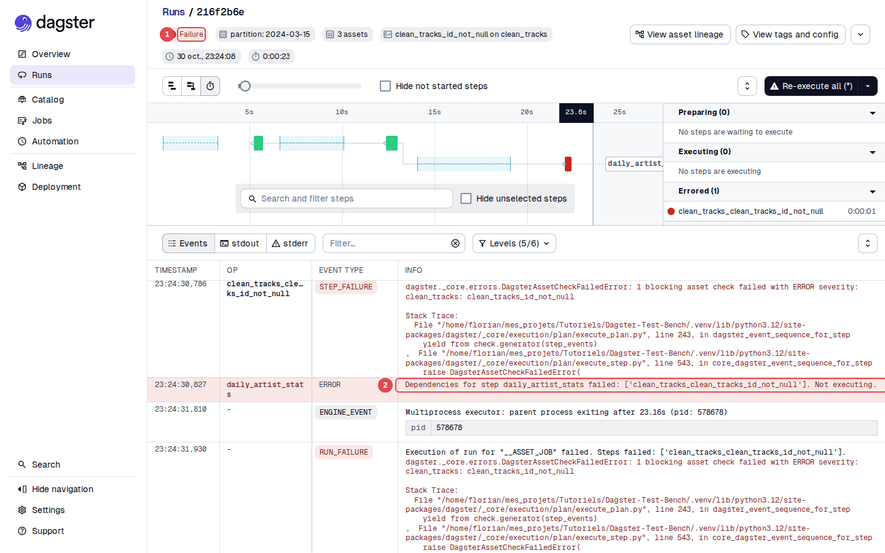

### Le check

**Ouvrez** **Catalog**, `clean_tracks`, **Checks**. Il indique **Failed** ① avec `null_count = 3` ②, et la courbe remonte.

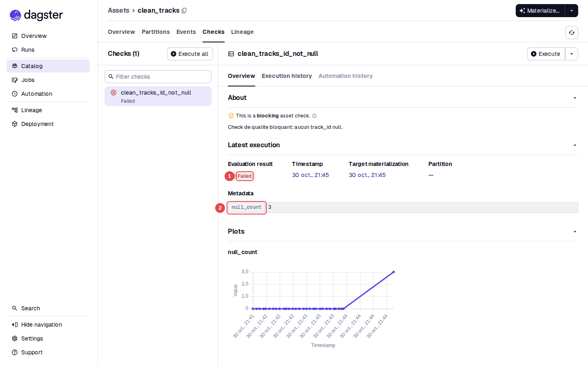

### Ce qui a été écrit, ou non

Dans **Partitions**, sélectionnez `2024-03-15` sur chacun des deux assets.

Sur `clean_tracks`, la partition est **Materialized** ① :

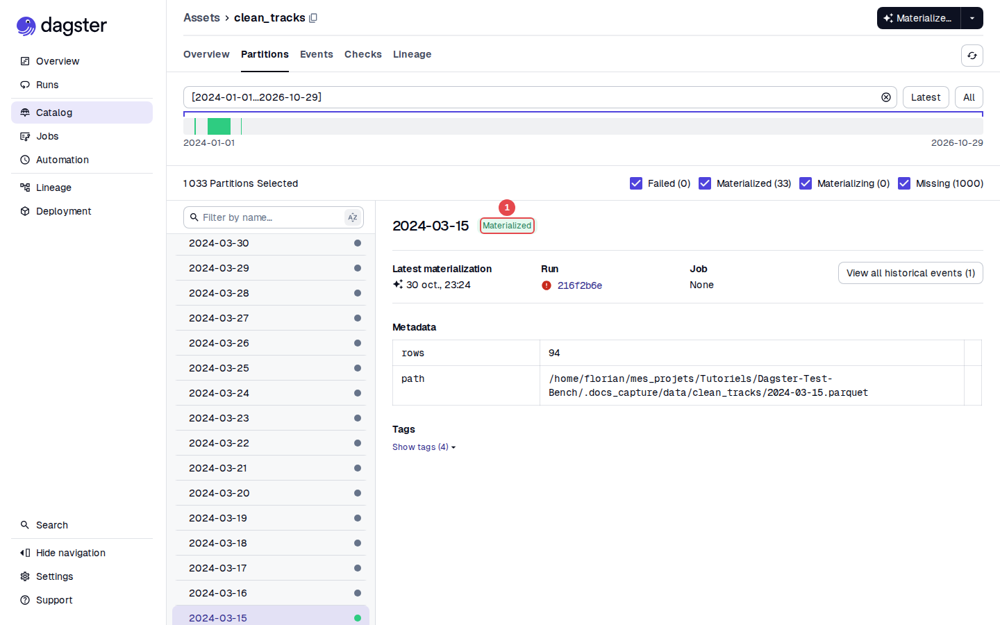

Sur `daily_artist_stats`, le message indique que le run a échoué sans produire cet asset ①, et le compteur affiche `Failed (1)` ② :

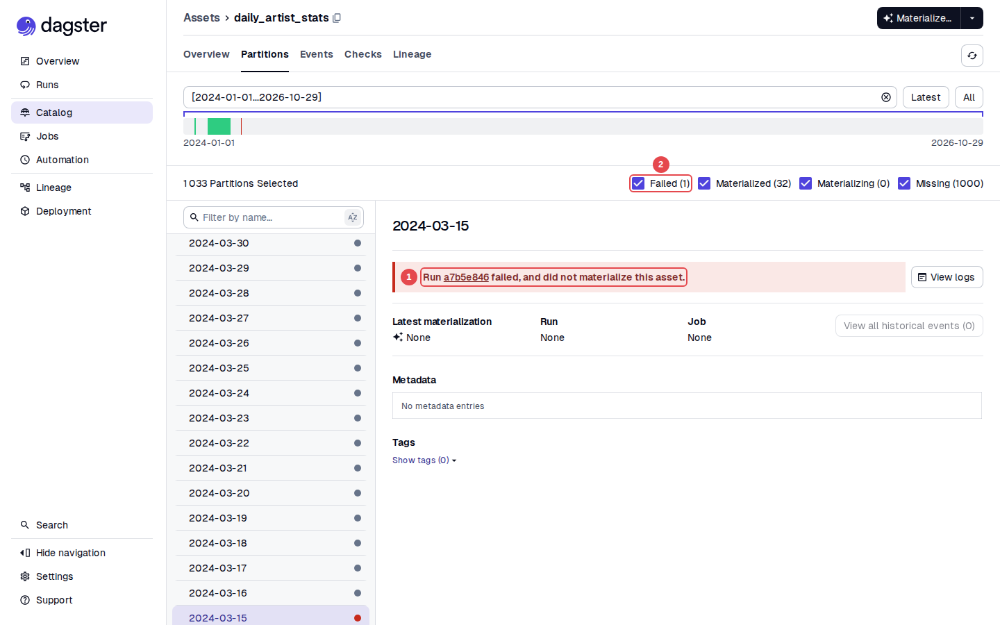

**Vérifiez-le sur le disque :**

```bash
find data -name '2024-03-15*' | sort
```

```text
data/clean_tracks/2024-03-15.parquet
data/raw_tracks_data/2024-03-15.parquet
```

```bash
uv run python -c "import pandas as pd; df = pd.read_parquet('data/clean_tracks/2024-03-15.parquet'); print('lignes', len(df), '- track_id vides', df.track_id.isna().sum())"
```

```text
lignes 94 - track_id vides 3
```

> **À retenir :** un check bloquant protège ce qui vient **après**, pas l'asset qu'il contrôle. Il s'exécute une fois `clean_tracks` écrit : les données fautives restent donc sur le disque jusqu'à la prochaine exécution.

### La même chose depuis l'interface

Vous pouvez aussi fournir la config dans la fenêtre de lancement :

1. Sur **Lineage**, cliquez sur **Materialize all…**, **Custom**, et saisissez `2024-03-20`.
2. Dépliez **Config**, puis cliquez sur **Add config**.
3. Collez le texte ci-dessous, puis cliquez sur **Save config** ①.
4. Cliquez sur **Launch 1 run**.

```yaml
ops:
  raw_tracks_data:
    config:
      null_track_ids: 3
```

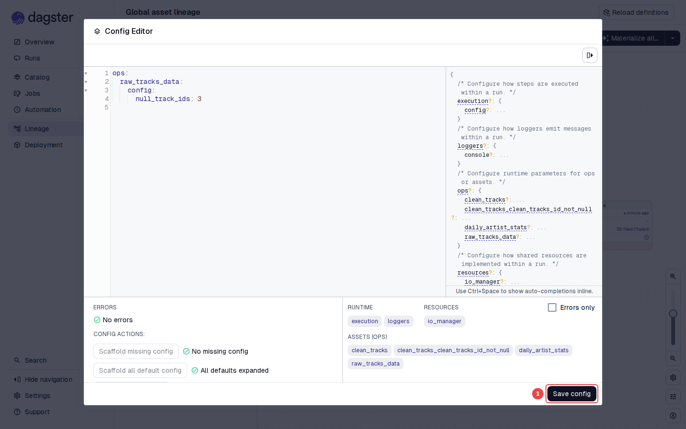

### Réparer

Relancez les partitions fautives sans config. Les fichiers sont remplacés et Gold est enfin produit :

```bash
uv run dagster asset materialize -m streamify_ops --select '*' --partition 2024-03-15
```

```bash
uv run dagster asset materialize -m streamify_ops --select '*' --partition 2024-03-20
```

Le check repasse à **Passed** ①, et sa courbe redescend à 0 :

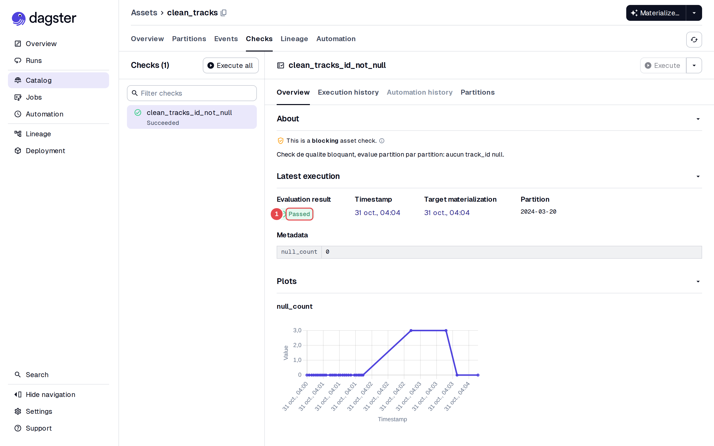

> **Attention :** le résultat du check n'est pas lié à une partition, comme le montre le champ **Partition** vide. Si vous n'aviez réparé que le 15 mars, il serait repassé à **Passed** alors que le 20 mars restait fautif. Pour repérer les dates à reprendre, fiez-vous au compteur **Failed** de la vue **Partitions**.

---

## 8. Activer le schedule

Le schedule lance `daily_streamify_job` chaque jour à 00:00 UTC, sur la partition de la veille. Il est arrêté par défaut.

**Dans le navigateur,** ouvrez **Automation**, dépliez `streamify_ops`, puis cliquez sur `daily_streamify_schedule`. L'interrupteur **Running** ① est désactivé.

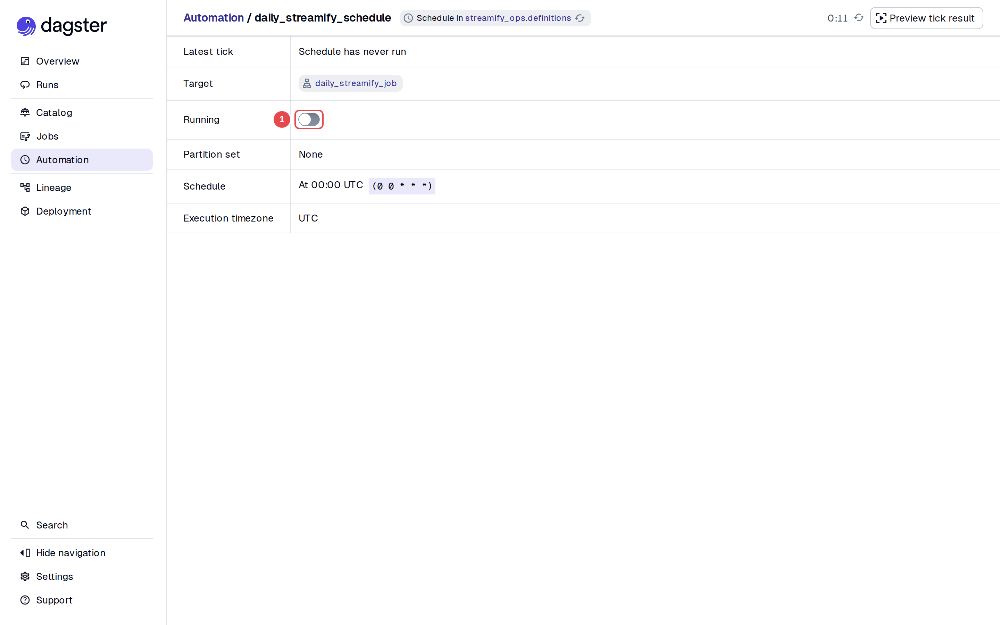

**Dans le terminal 2,** interrogez le même état. Parmi les lignes de log, vous verrez :

```bash
uv run dagster schedule list -m streamify_ops
```

```text
Schedule: daily_streamify_schedule [STOPPED]
Cron Schedule: 0 0 * * *
```

Démarrez-le :

```bash
uv run dagster schedule start -m streamify_ops daily_streamify_schedule
```

```text
Started schedule daily_streamify_schedule
```

**Rechargez la page.** L'interrupteur est activé ① et une ligne **Next tick** indique le prochain déclenchement.

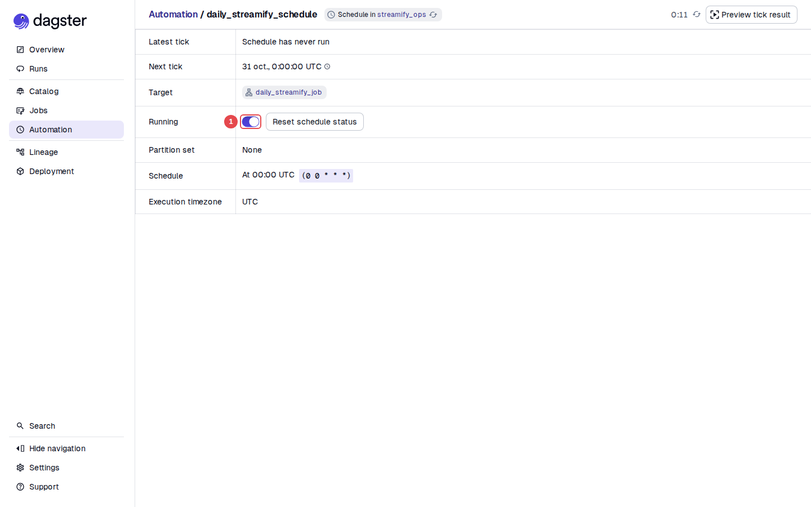

Pour voir ce qu'il ferait sans attendre minuit, cliquez sur **Preview tick result**, puis sur **Continue**. Dagster simule le déclenchement : une demande de run ① sur `daily_streamify_job` ②.

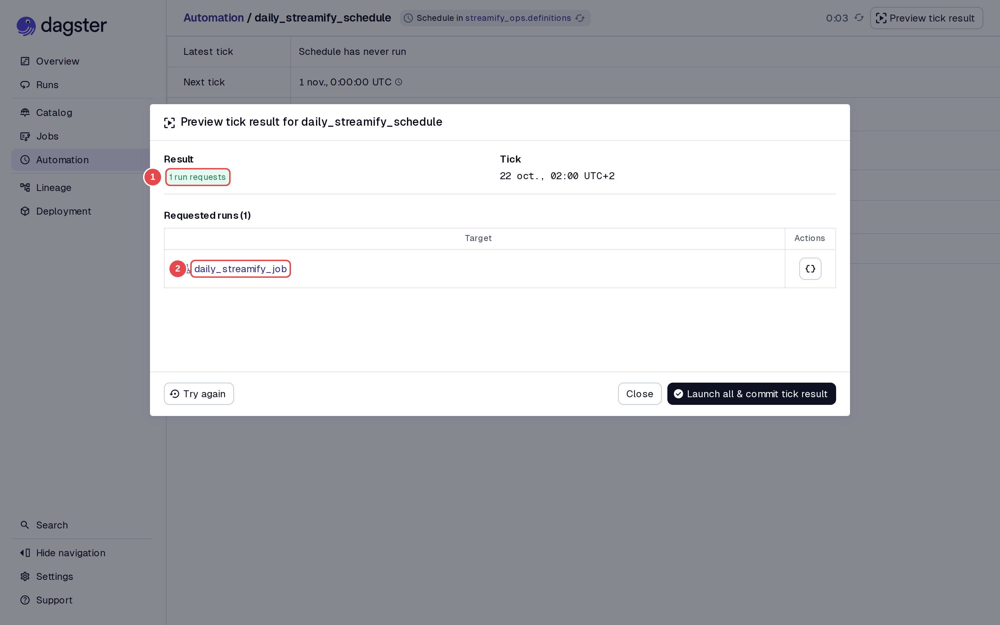

Cliquez sur **Close**. **Launch all & commit tick result** lancerait un vrai run.

Arrêtez le schedule pour terminer :

```bash
uv run dagster schedule stop -m streamify_ops daily_streamify_schedule
```

> Un schedule ne se déclenche que si `dagster dev` tourne à ce moment-là : c'est lui qui fait fonctionner le service d'arrière-plan chargé de surveiller l'heure.

---

## 9. Lancer les tests

**Dans le terminal 2 :**

```bash
uv run pytest
```

```text
6 passed, 3 warnings
```

**Regardez maintenant l'interface :** aucun nouveau run, et aucun nouveau fichier dans `data/`. Les tests utilisent une instance temporaire, en mémoire ou dans un dossier jetable. Vous pouvez donc tester le pipeline sans toucher à votre historique.

Ils vérifient aussi ce que vous venez d'observer : le check est bien enregistré, un échec bloque Gold, et le schedule vise la veille.

---

## Pour finir

Arrêtez le serveur avec `Ctrl+C` dans le terminal 1. Votre historique reste dans `.dagster_home/` et vos données dans `data/` : ils seront là au prochain lancement.

Pour explorer le code derrière ce que vous avez vu :

| Vous avez vu… | Le code est dans… |
|---|---|
| Les trois assets et leurs dépendances | [`streamify_ops/assets/`](streamify_ops/assets/) |
| Le check bloquant | [`transformation.py`](streamify_ops/assets/transformation.py) |
| L'anomalie `null_track_ids` | [`ingestion.py`](streamify_ops/assets/ingestion.py) |
| L'aperçu en tableau | [`analytics.py`](streamify_ops/assets/analytics.py) |
| Les fichiers Parquet de `data/` | [`local_filesystem_io_manager.py`](streamify_ops/resources/local_filesystem_io_manager.py) |
| Le déclenchement quotidien | [`schedules.py`](streamify_ops/schedules.py) |
