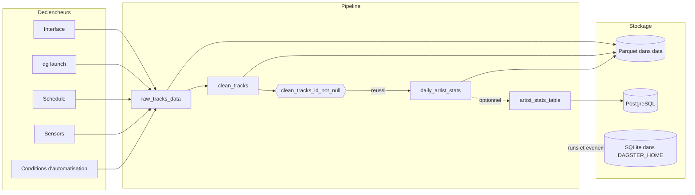

# Architecture — Dagster Test Bench

## 1. Vue d'ensemble

Le projet fait tourner **un pipeline de trois assets**, partitionné par jour, sur une seule machine. `dg dev` démarre l'interface, le daemon et le serveur de code. Les données simulées sont écrites en **Parquet** dans `data/`, et l'historique des exécutions dans des bases **SQLite** sous `$DAGSTER_HOME`. Une base **PostgreSQL** en Docker est utilisée seulement par l'export optionnel de l'[étape 10 du tutoriel](../TUTORIAL.md#10-publier-dans-postgresql).

Ce document décrit la **structure** du système. Pour l'usage, voir le [manuel utilisateur](manuel-utilisateur.md) et le [tutoriel](../TUTORIAL.md). Pour les données, voir [STORAGE.md](STORAGE.md). Pour la sécurité, voir [SECURITY.md](SECURITY.md).

---

## 2. Services / Composants

### Processus

| Service | Image / Build | Port interne | Port hôte | Rôle |
|---|---|---|---|---|
| Interface web et GraphQL | processus local, `dg dev` | 3000 | 3000 (`127.0.0.1`) | Graphe, runs, catalogue, automatisation |
| Daemon | processus local, `dg dev` | – | – | Schedules, sensors, backfills, file d'attente, fraîcheur |
| Serveur de code | processus local, `dg dev` | – | – | Charge les définitions du projet |
| `postgres` | `postgres:16-alpine` | 5432 | 5434 (`127.0.0.1`) | Table `artist_stats`, export optionnel |

### Définitions chargées par défaut

| Type | Nom | Déclaration | Comportement |
|---|---|---|---|
| Asset | `raw_tracks_data` | [`ingestion.py`](../src/streamify_ops/defs/assets/ingestion.py) | Bronze : **100 lignes** simulées, `on_cron("0 1 * * *")`, 2 nouvelles tentatives |
| Asset | `clean_tracks` | [`transformation.py`](../src/streamify_ops/defs/assets/transformation.py) | Silver : genres en majuscules, durées négatives retirées, `eager()` |
| Check | `clean_tracks_id_not_null` | [`transformation.py`](../src/streamify_ops/defs/assets/transformation.py) | Bloquant, évalué par partition (*preview*) |
| Asset | `daily_artist_stats` | [`analytics.py`](../src/streamify_ops/defs/assets/analytics.py) | Gold : titres par artiste, `eager()`, fraîcheur 26 h et 48 h |
| Job | `daily_streamify_job` | [`jobs.py`](../src/streamify_ops/defs/jobs.py) | Tous les assets, partitions journalières |
| Schedule | `daily_streamify_schedule` | [`schedules.py`](../src/streamify_ops/defs/schedules.py) | `0 0 * * *` UTC, sur la veille, arrêté par défaut |
| Sensor | `inbox_file_sensor` | [`sensors.py`](../src/streamify_ops/defs/sensors.py) | Toutes les 10 s environ, un run par fichier `AAAA-MM-JJ.ready` |
| Sensor | `alert_on_run_failure` | [`sensors.py`](../src/streamify_ops/defs/sensors.py) | Écrit une alerte par run en échec |
| Sensor | `default_automation_condition_sensor` | Créé par Dagster | Évalue les conditions d'automatisation, arrêté par défaut |
| Ressource | `io_manager` | [`defs/resources.py`](../src/streamify_ops/defs/resources.py) | [`LocalFilesystemIOManager`](../src/streamify_ops/resources/local_filesystem_io_manager.py) : Parquet et métadonnées standard |

### Définitions optionnelles

Ces deux fichiers s'activent par simple copie dans `defs/assets/`, suivie de **Reload definitions**.

| Fichier | Apporte | Démontre |
|---|---|---|
| [`weekly_artist_stats.py`](../src/streamify_ops/optional/weekly_artist_stats.py) | Asset `weekly_artist_stats` | Dépendance sur **7 partitions** avec `TimeWindowPartitionMapping` |
| [`artist_stats_table.py`](../src/streamify_ops/optional/artist_stats_table.py) | Asset `artist_stats_table`, ressource `postgres` | [`PostgresResource`](../src/streamify_ops/resources/postgres.py), `EnvVar`, relance après panne |

### Chargement

[`definitions.py`](../src/streamify_ops/definitions.py) appelle `load_from_defs_folder` : tout module placé sous `defs/` est chargé, sans liste à tenir à jour. Dans un module qui contient un `@definitions`, seul ce que renvoie cette fonction est retenu : l'asset doit donc y figurer, comme dans `artist_stats_table.py`.

---

## 3. Stack technologique

Versions figées par [`uv.lock`](../uv.lock) et [`.python-version`](../.python-version).

| Couche | Technologie | Version |
|---|---|---|
| Langage | Python | 3.12 |
| Orchestration | Dagster, `dagster-webserver` | 1.13.28 |
| Ligne de commande | `dagster-dg-cli` | 1.13.28 |
| Traitement | pandas | 3.0.6 |
| Format de fichier | PyArrow, Parquet | 25.0.1 |
| Données simulées | Faker | 40.40.0 |
| Base de données | PostgreSQL, image `postgres:16-alpine` | 16 |
| Client PostgreSQL | psycopg | 3.3.6 |
| Tests et format | pytest, Black | 9.1.1, 26.10.1 |

---

## 4. Flux de bout en bout

### Matérialisation d'une date

1. Un déclencheur demande une partition, c'est-à-dire une journée.
2. `raw_tracks_data` génère les lignes à partir de la date. Le même jour donne donc les mêmes données.
3. L'IO Manager écrit le fichier Parquet et publie le chemin, le nombre de lignes et le schéma.
4. `clean_tracks` relit Bronze, nettoie, puis l'IO Manager écrit Silver.
5. Le check contrôle Silver. **En cas d'échec, Gold n'est pas calculé**, mais Silver reste écrit.
6. `daily_artist_stats` agrège et écrit Gold.
7. Si l'export est activé, `artist_stats_table` remplace les lignes de la date dans PostgreSQL.

### Déclencheurs

| Déclencheur | Condition | Portée | État par défaut |
|---|---|---|---|
| **Materialize all…** | Clic | Dates choisies | – |
| `dg launch` | Commande | Date choisie | – |
| `daily_streamify_schedule` | 00:00 UTC | La veille | Arrêté |
| `inbox_file_sensor` | Nouveau fichier `.ready` | La date du fichier | Arrêté |
| `on_cron` sur Bronze | 01:00 UTC | La veille | Arrêté |
| `eager` sur Silver et Gold | Mise à jour en amont | La veille | Arrêté |

---

## 5. Réseaux & volumes

Seule la base passe par Docker, avec les noms ci-dessous lorsque le dépôt est cloné dans un dossier `Dagster-Test-Bench`.

| Réseau | Services | Rôle |
|---|---|---|
| `dagster-test-bench_default` | `postgres` | Réseau par défaut de Docker Compose |

| Volume | Monté par | Contenu |
|---|---|---|
| `dagster-test-bench_streamify_pg` | `postgres` | Données de la base, supprimées par `docker compose down -v` |

---

## 6. Décisions d'architecture

- **Assets et non tâches** : le pipeline déclare des données *plutôt que* des étapes à enchaîner, *parce que* le projet sert à apprendre ce modèle. Les dépendances se déduisent des paramètres des fonctions. *Limite* : les données sont simulées, aucune source réelle n'est lue.
- **Check partitionné** *plutôt que* global, *parce que* le check global ne se rattachait à aucune date et que son bouton **Execute** échouait avec `DagsterExecutionLoadInputError`. *Limite* : Dagster classe cette fonction en *preview*, et **Execute** est désactivé.
- **Schedule déduit des partitions** avec `build_schedule_from_partitioned_job` *plutôt que* calcul manuel de la veille, *parce que* le cron et la partition visée ne peuvent plus diverger. *Limite* : le cron suit le découpage des partitions.
- **Structure `dg` et dossier `defs/`** *plutôt qu'*une liste explicite dans `Definitions`, *parce qu'*un nouvel asset se charge sans autre modification. *Limite* : `dg` ne pilote pas les schedules et les sensors, qui passent encore par `dagster -m streamify_ops.definitions`.
- **`code_location_name` fixé** *plutôt que* le nom par défaut, tiré du dossier, *parce que* l'interface n'affichait pas l'état des schedules et sensors démarrés en ligne de commande tant que les deux noms différaient. *Limite* : un nom technique apparaît dans l'interface.
- **`monitor_all_code_locations=True` sur le sensor d'échec**, *parce que* les runs de `dg launch` n'ont pas d'emplacement de code d'origine et seraient ignorés sinon. *Limite* : le sensor surveillerait tout emplacement ajouté à l'instance.
- **Assets optionnels hors de `defs/`** *plutôt que* chargés d'office, *parce que* le parcours principal reste à trois assets et ne dépend ni de Docker ni d'une fenêtre de 7 jours. *Limite* : `test_assets_are_grouped_by_layer` échoue tant qu'un asset optionnel reste actif.
- **Export PostgreSQL en asset séparé** *plutôt qu'*un IO Manager PostgreSQL, *parce que* Parquet reste la source du pipeline et qu'une panne de la base n'invalide pas Gold : **From failure** ne rejoue que l'export. *Limite* : la donnée existe en deux endroits.
- **Remplacement par date** (`DELETE` puis `INSERT` dans une transaction) *plutôt qu'*un simple ajout, *parce que* relancer une date ne crée pas de doublon. *Limite* : le coût croît avec le volume d'une partition.
- **Mode accéléré** `STREAMIFY_FAST_AUTOMATION` *plutôt qu'*une attente réelle, *parce qu'*un cron quotidien et une fraîcheur de 26 h ne s'observent pas dans un tutoriel. *Limite* : les valeurs de production ne sont vérifiées qu'en temps simulé.
- **`BackfillPolicy.single_run` non retenue** : un seul run pour plusieurs dates aurait permis `--partition-range`, mais aurait compliqué les assets et l'IO Manager. *Limite* : un backfill lance **un run par date**.

---

## 7. Sécurité (récapitulatif)

Le détail figure dans [SECURITY.md](SECURITY.md).

| Durcissement | Effet |
|---|---|
| Interface et base liées à `127.0.0.1` | Pas d'accès depuis une autre machine |
| Mot de passe via `EnvVar` | Absent du code et de l'historique de Dagster |
| Dépendances figées et auditées | Aucune faille connue à la date de l'audit |

---

## 8. Limites connues & pistes

| Aspect | Limitation / État | Recommandation |
|---|---|---|
| Déploiement | Uniquement `dg dev`, instance SQLite locale | Couvrir Docker et une instance PostgreSQL pour Dagster |
| dbt | Non couvert | Ajouter un projet dbt relié aux assets |
| Partitions | Journalières uniquement | Couvrir les partitions dynamiques et multidimensionnelles |
| Double déclenchement | Schedule et `on_cron` actifs ensemble recalculent la veille | Choisir l'un ou l'autre, comme l'indique le manuel |
| `on_missing()` | Vérifié par un test en temps simulé, sur aucun asset du projet | Pas d'action tant qu'aucun asset n'en a besoin |
| `on_cron` à 01:00 UTC | Déclenchement réel observé en mode accéléré, valeur de production en temps simulé | Observer un déclenchement réel sur une nuit |
| **From failure** | Échoue sur un run de `dg launch` avec `CheckError` | Lancer depuis l'interface un run à relancer |
| Captures | Le script a tourné en deux passages depuis l'ajout de PostgreSQL | Le relancer d'un seul bloc à la prochaine mise à jour |
| Outils de capture | Playwright et Pillow non figés par `uv.lock` | Les ajouter à un groupe de dépendances si le script devient critique |
