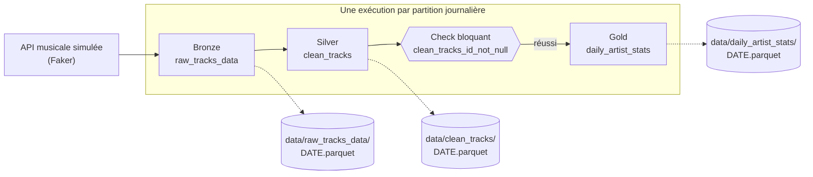

# Manuel utilisateur — Dagster Test Bench

Ce manuel présente le projet et sert de référence : ce qu'il fait, comment le lancer, où lire chaque information dans l'interface. Pour apprendre en manipulant, suivez plutôt le [tutoriel pas à pas](../TUTORIAL.md).

> Captures réalisées avec **Dagster 1.13.28**, la version fixée par `uv.lock`. Elles se régénèrent avec une seule commande : voir [§ 9](#9-régénérer-les-captures).

---

## 1. En bref

**Dagster Test Bench** est un banc d'essai pour découvrir l'orchestrateur de données [Dagster](https://dagster.io). Il fait tourner un petit pipeline musical, *Streamify-Ops*, sur votre machine, sans base de données ni service externe.

| | |
|---|---|
| **Pour qui** | Toute personne qui veut comprendre Dagster en le voyant fonctionner |
| **Ce que vous obtenez** | Un pipeline à trois étages, partitionné par jour, avec contrôle qualité, rattrapage et planification |
| **Données** | Simulées avec Faker : 100 écoutes fictives par jour, à partir du 2024-01-01 |
| **Ce que ce n'est pas** | Un modèle de production : le stockage est local et il n'y a ni authentification ni déploiement |

Dagster raisonne en **données à produire** (*assets*) plutôt qu'en tâches à enchaîner. Vous déclarez chaque table et ce dont elle dépend ; Dagster en déduit l'ordre d'exécution et garde l'historique de chacune.

---

## 2. Le pipeline



| Couche | Asset | Traitement | Résultat type | Code |
|---|---|---|---|---|
| Bronze | `raw_tracks_data` | Génère les écoutes brutes du jour | 100 lignes | [`ingestion.py`](../streamify_ops/assets/ingestion.py) |
| Silver | `clean_tracks` | Met le genre en majuscules, retire les durées négatives | Environ 90 à 100 lignes | [`transformation.py`](../streamify_ops/assets/transformation.py) |
| Gold | `daily_artist_stats` | Compte les titres par artiste | 20 lignes au plus, une par artiste | [`analytics.py`](../streamify_ops/assets/analytics.py) |

Le check `clean_tracks_id_not_null` vérifie qu'aucun `track_id` n'est vide. S'il échoue, `daily_artist_stats` n'est pas calculé.

---

## 3. Les concepts, et où les voir

| Concept | En une phrase | Dans l'interface | Dans le code |
|---|---|---|---|
| **Asset** | Une donnée que le pipeline produit | **Lineage**, **Catalog** | `@asset` |
| **Matérialisation** | L'exécution qui produit ou actualise un asset | **Catalog** → asset → **Events** | Bouton ou `dagster asset materialize` |
| **Partition** | Une tranche de données, ici une journée | **Catalog** → asset → **Partitions** | `DailyPartitionsDefinition` |
| **Run** | Une exécution, avec ses étapes et ses logs | **Runs** | – |
| **Backfill** | Un rattrapage de plusieurs partitions | **Runs** → **Backfills** | – |
| **Asset check** | Un contrôle qualité attaché à un asset | **Catalog** → asset → **Checks** | `@asset_check` |
| **IO Manager** | Le composant qui lit et écrit les données | Métadonnée `path` | [`LocalFilesystemIOManager`](../streamify_ops/resources/local_filesystem_io_manager.py) |
| **Job** | Une sélection d'assets à exécuter ensemble | **Jobs** | [`daily_streamify_job`](../streamify_ops/jobs.py) |
| **Schedule** | Le déclenchement automatique d'un job | **Automation** | [`daily_streamify_schedule`](../streamify_ops/schedules.py) |

---

## 4. Installer et lancer

**Prérequis :** [`uv`](https://docs.astral.sh/uv/) installé. Il fournit lui-même Python 3.12, la version indiquée par `.python-version`.

```bash
uv sync --extra dev
```

```bash
export DAGSTER_HOME="$PWD/.dagster_home"
```

```bash
mkdir -p "$DAGSTER_HOME"
```

```bash
uv run dagster dev -m streamify_ops
```

L'interface s'ouvre sur [http://localhost:3000](http://localhost:3000). Le serveur occupe le terminal : lancez vos autres commandes dans un second terminal.

> **`DAGSTER_HOME` est indispensable pour ce projet.** C'est le dossier où Dagster garde l'historique. Exportez-le dans **chaque** terminal : sans lui, une commande ne parle pas à la même instance que l'interface, et son run n'y apparaît pas.

Au premier lancement, une fenêtre propose de rejoindre la communauté Dagster. Cliquez sur **Skip** ; aucune adresse e-mail n'est nécessaire.


---

## 5. Se repérer dans l'interface

| Menu | À quoi il sert | Exemple |
|---|---|---|
| **Lineage** | Voir le graphe et l'état de chaque asset, tout lancer | [Graphe](images/02-lignage-vide.png) |
| **Runs** | Suivre les exécutions et lire leurs logs | [Liste](images/06-runs-interface-et-cli.png), [détail](images/05-run-termine.png), [backfill](images/11-backfill-en-cours.png) |
| **Catalog** | Consulter un asset : partitions, événements, checks | [Partitions](images/07-partitions-apres-cli.png), [événements](images/08-metadonnees-gold.png), [checks](images/09-check-reussi.png) |
| **Jobs** | Voir les jobs définis | `daily_streamify_job` |
| **Automation** | Activer ou arrêter les schedules | [Schedule](images/22-schedule-arrete.png) |

### Lire une carte du graphe


| Ligne | Signification |
|---|---|
| **Latest event** | Date de la dernière matérialisation |
| **Asset checks** | Dernier résultat des checks, par exemple `1 / 1 Passed` |
| **Partitions** | Part des partitions déjà produites |
| **Automation** | Présence d'une planification |
| **1033 partitions** | Nombre de jours depuis le 2024-01-01 : ce total augmente chaque jour |

### Lire la vue des partitions

Une barre résume tout l'historique : **vert** pour une partition produite, **rouge** pour un échec, **gris** pour une partition manquante. Cliquez sur une date pour lire ses métadonnées.


---

## 6. Correspondance commandes ↔ interface ↔ disque

Toutes ces commandes supposent `DAGSTER_HOME` exporté et `uv run` en préfixe, et s'exécutent depuis la racine du projet.

| Commande | Ce que vous voyez dans l'interface | Ce qui change sur le disque |
|---|---|---|
| `dagster dev -m streamify_ops` | L'interface et le graphe | `.dagster_home/` se remplit |
| `dagster asset list -m streamify_ops` | Les mêmes assets que **Catalog** | Rien |
| `dagster asset materialize -m streamify_ops --select '*' --partition 2024-01-16` | Un run dans **Runs** ; la partition passe au vert | `data/*/2024-01-16.parquet`, 3 fichiers |
| La même, avec `--config-json '{"ops":{"raw_tracks_data":{"config":{"null_track_ids":3}}}}'` | Run en **Failure**, check **Failed**, Gold en rouge | Bronze et Silver écrits, **pas** Gold |
| `dagster schedule list -m streamify_ops` | L'état affiché dans **Automation** | Rien |
| `dagster schedule start -m streamify_ops daily_streamify_schedule` | L'interrupteur **Running** s'active | Rien |
| `dagster schedule stop -m streamify_ops daily_streamify_schedule` | L'interrupteur **Running** se désactive | Rien |
| `pytest` | **Rien** : les tests n'utilisent pas votre instance | **Rien** : ils écrivent en mémoire ou en dossier temporaire |

Dans l'autre sens, **Materialize all…** dans **Lineage** produit le même résultat qu'une commande `dagster asset materialize`. L'interface et la ligne de commande ne sont que deux façons de piloter la même instance.

---

## 7. Comportements à connaître

Ces points surprennent souvent et sont illustrés dans le tutoriel.

- **Le check bloque la suite, pas l'écriture de l'asset qu'il contrôle.** Il s'exécute après `clean_tracks` : la partition Silver fautive reste écrite dans `data/clean_tracks/` et apparaît en vert. Seul `daily_artist_stats` est bloqué. Relancez la partition pour remplacer le fichier.
- **Le check est évalué par partition.** Son onglet **Partitions** donne le résultat de chaque date, et son statut global reste **Failed** tant qu'une date est fautive. Le bouton **Execute** est désactivé : pour le rejouer, relancez la partition. Dagster classe cette fonction en *preview*, pas encore considérée comme prête pour la production.
- **La fenêtre de lancement ne propose d'abord que les 90 derniers jours.** Pour une date plus ancienne, cliquez sur **Show all partitions** avant **Custom**.
- **Materialize all ne passe pas par `daily_streamify_job`.** Il lance un job interne nommé `__ASSET_JOB`. Le job nommé n'est utilisé que par le schedule, d'où la mention `Job: None` dans la vue d'une partition.
- **Un schedule n'agit que si `dagster dev` tourne.** Il se déclenche à 00:00 UTC et traite la veille. Il est arrêté par défaut.
- **« Preview tick result » n'exécute rien** tant que vous ne cliquez pas sur **Launch all & commit tick result**, qui lance un vrai run.
- **Un backfill lance un run par partition.** Sur la machine de test, 30 partitions ont pris environ 3 minutes.

---

## 8. Dépannage

| Symptôme | Cause | Solution |
|---|---|---|
| `Failed to spawn: dagster` | Le `.venv` a été créé avant le déplacement ou le renommage du dossier | `uv venv --clear --python 3.12`, puis `uv sync --extra dev` |
| Un run lancé en ligne de commande n'apparaît pas dans **Runs** | `DAGSTER_HOME` n'est pas exporté dans ce terminal | Exportez-le dans chaque terminal avec la même valeur |
| `$DAGSTER_HOME ... is not a directory` | Le dossier n'existe pas encore | `mkdir -p "$DAGSTER_HOME"` |
| L'interface ne répond pas sur le port 3000 | Le port est déjà pris | `uv run dagster dev -m streamify_ops -p 3001` |
| `Could not find partition` dans la fenêtre de lancement | La date sort des 90 derniers jours proposés | Cliquez sur **Show all partitions** avant **Custom** |
| Le check reste en **Not evaluated** | Aucun run n'a encore inclus `clean_tracks` | Matérialisez une partition |
| Vous voulez repartir de zéro | L'historique et les données sont séparés | Arrêtez le serveur, puis `rm -rf .dagster_home data/*/` et `mkdir -p .dagster_home` |

---

## 9. Régénérer les captures

Le script rejoue le tutoriel sur une instance jetable, dans `.docs_capture/`, sans toucher à vos données ni à votre historique. Comptez environ 6 minutes.

```bash
uv run --with playwright playwright install chromium
```

```bash
uv run --with playwright --with pillow python scripts/capture_docs.py
```

Il remplace le contenu de `documentation/images/` et conserve les sorties brutes des commandes dans `.docs_capture/cli/`. Sur les captures, les chemins contiennent donc `.docs_capture/data/` là où vous verrez `data/`.
