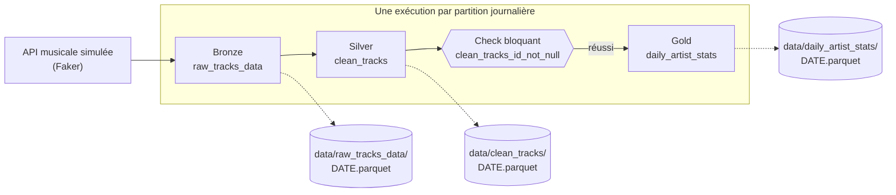

# Manuel utilisateur — Dagster Test Bench

Ce manuel présente le projet et sert de référence : ce qu'il fait, comment le lancer, où lire chaque information dans l'interface. Pour apprendre en manipulant, suivre plutôt le [tutoriel pas à pas](../TUTORIAL.md). Pour la structure technique, voir [l'architecture](architecture.md) ; pour les données, [le stockage](STORAGE.md) ; pour les secrets et l'exposition réseau, [la sécurité](SECURITY.md).

> Captures réalisées avec **Dagster 1.13.28**, la version fixée par `uv.lock`. Elles se régénèrent avec une seule commande : voir [§ 10](#10-régénérer-les-captures).

---

## 1. En bref

**Dagster Test Bench** est un banc d'essai pour découvrir l'orchestrateur de données [Dagster](https://dagster.io). Il fait tourner un petit pipeline musical, *Streamify-Ops*, sur la machine locale, sans base de données ni service externe.

| | |
|---|---|
| **Pour qui** | Toute personne qui veut comprendre Dagster en le voyant fonctionner |
| **Résultat obtenu** | Un pipeline à trois étages, partitionné par jour, avec contrôle qualité, rattrapage, planification et automatisation |
| **Données** | Simulées avec Faker : 100 écoutes fictives par jour, à partir du 2024-01-01 |
| **Ce que ce n'est pas** | Un modèle de production : le stockage est local et il n'y a ni authentification ni déploiement |

Dagster raisonne en **données à produire** (*assets*) plutôt qu'en tâches à enchaîner. Chaque table est déclarée avec ses dépendances ; Dagster en déduit l'ordre d'exécution et garde l'historique de chacune.

---

## 2. Le pipeline



| Couche | Asset | Traitement | Résultat type | Code |
|---|---|---|---|---|
| Bronze | `raw_tracks_data` | Génère les écoutes brutes du jour | 100 lignes | [`ingestion.py`](../src/streamify_ops/defs/assets/ingestion.py) |
| Silver | `clean_tracks` | Met le genre en majuscules, retire les durées négatives | Environ 90 à 100 lignes | [`transformation.py`](../src/streamify_ops/defs/assets/transformation.py) |
| Gold | `daily_artist_stats` | Compte les titres par artiste | 20 lignes au plus, une par artiste | [`analytics.py`](../src/streamify_ops/defs/assets/analytics.py) |

Chaque asset appartient au groupe de sa couche (`bronze`, `silver`, `gold`) et publie des métadonnées standard : nombre de lignes, schéma des colonnes et chemin du fichier.

Le check `clean_tracks_id_not_null` vérifie qu'aucun `track_id` n'est vide. S'il échoue, `daily_artist_stats` n'est pas calculé.

---

## 3. Les concepts, et où les voir

| Concept | En une phrase | Dans l'interface | Dans le code |
|---|---|---|---|
| **Asset** | Une donnée que le pipeline produit | **Lineage**, **Catalog** | `@asset` |
| **Matérialisation** | L'exécution qui produit ou actualise un asset | **Catalog** → asset → **Events** | Bouton ou `dg launch` |
| **Partition** | Une tranche de données, ici une journée | **Catalog** → asset → **Partitions** | `DailyPartitionsDefinition` |
| **Run** | Une exécution, avec ses étapes et ses logs | **Runs** | – |
| **Backfill** | Un rattrapage de plusieurs partitions | **Runs** → **Backfills** | – |
| **Asset check** | Un contrôle qualité attaché à un asset | **Catalog** → asset → **Checks** | `@asset_check` |
| **IO Manager** | Le composant qui lit et écrit les données | Métadonnée `dagster/uri` | [`LocalFilesystemIOManager`](../src/streamify_ops/resources/local_filesystem_io_manager.py) |
| **Job** | Une sélection d'assets à exécuter ensemble | **Jobs** | [`daily_streamify_job`](../src/streamify_ops/defs/jobs.py) |
| **Schedule** | Le déclenchement d'un job à heure fixe | **Automation** | [`daily_streamify_schedule`](../src/streamify_ops/defs/schedules.py) |
| **Condition d'automatisation** | La règle qui dit quand recalculer un asset | **Catalog** → asset → **Automation** | `AutomationCondition` |
| **Sensor** | Un code exécuté à intervalle régulier, qui peut lancer un run | **Automation** | [`sensors.py`](../src/streamify_ops/defs/sensors.py) |
| **Politique de fraîcheur** | Le délai au-delà duquel un asset est signalé comme périmé | **Catalog** → asset → **Overview** | `FreshnessPolicy` |
| **Retry** | Une nouvelle tentative après l'échec d'une étape | **Runs** → run | `RetryPolicy` |
| **Ressource** | Un objet de connexion injecté dans les assets qui le demandent | **Deployment** → emplacement de code → **Definitions** → **Resources** | [`PostgresResource`](../src/streamify_ops/resources/postgres.py) |

---

## 4. Installer et lancer

**Prérequis :** [`uv`](https://docs.astral.sh/uv/) installé. Il fournit lui-même Python 3.12, la version indiquée par `.python-version`.

```bash
uv sync --extra dev
```

```bash
export DAGSTER_HOME="$PWD/.dagster_home"
```

```bash
mkdir -p "$DAGSTER_HOME"
```

```bash
uv run dg dev
```

L'interface s'ouvre sur [http://localhost:3000](http://localhost:3000). Le serveur occupe le terminal : les autres commandes se lancent dans un second terminal.

> **`DAGSTER_HOME` est indispensable pour ce projet.** C'est le dossier où Dagster garde l'historique. L'exporter dans **chaque** terminal : sans lui, une commande ne parle pas à la même instance que l'interface, et son run n'y apparaît pas.

Au premier lancement, une fenêtre propose de rejoindre la communauté Dagster. Cliquer sur **Skip** ; aucune adresse e-mail n'est nécessaire.


---

## 5. Se repérer dans l'interface

| Menu | À quoi il sert | Exemple |
|---|---|---|
| **Lineage** | Voir le graphe et l'état de chaque asset, tout lancer. Les groupes sont repliés : roue dentée, puis **Expand all groups** | [Graphe](images/02-lignage-vide.png) |
| **Runs** | Suivre les exécutions et lire leurs logs | [Liste](images/06-runs-interface-et-cli.png), [détail](images/05-run-termine.png), [backfill](images/11-backfill-en-cours.png) |
| **Catalog** | Consulter un asset : vue d'ensemble, partitions, événements, checks | [Vue d'ensemble](images/08b-vue-ensemble-asset.png), [partitions](images/07-partitions-apres-cli.png), [événements](images/08-metadonnees-gold.png), [checks](images/09-check-reussi.png) |
| **Jobs** | Voir les jobs définis | `daily_streamify_job` |
| **Automation** | Activer ou arrêter les schedules et les sensors | [Liste](images/25-automation-liste.png), [schedule](images/22-schedule-arrete.png), [sensor](images/28-sensor-fichier.png) |

### Lire une carte du graphe


| Ligne | Signification |
|---|---|
| **Latest event** | Date de la dernière matérialisation |
| **Asset checks** | Dernier résultat des checks, par exemple `1 / 1 Passed` |
| **Partitions** | Part des partitions déjà produites |
| **Automation** | Présence d'un schedule, d'un sensor ou d'une condition d'automatisation |
| **1034 partitions** | Nombre de jours depuis le 2024-01-01 : ce total augmente chaque jour |

### Lire la vue des partitions

Une barre résume tout l'historique : **vert** pour une partition produite, **rouge** pour un échec, **gris** pour une partition manquante. Cliquer sur une date pour lire ses métadonnées.


---

## 6. Correspondance commandes ↔ interface ↔ disque

Toutes ces commandes supposent `DAGSTER_HOME` exporté et `uv run` en préfixe, et s'exécutent depuis la racine du projet.

| Commande | Visible dans l'interface | Ce qui change sur le disque |
|---|---|---|
| `dg dev` | L'interface et le graphe | `.dagster_home/` se remplit |
| `dg check defs` | Rien : vérifie que les définitions se chargent | Rien |
| `dg list defs` | Les mêmes objets que **Catalog**, **Jobs** et **Automation** | Rien |
| `dg launch --assets '*' --partition 2024-01-16` | Un run dans **Runs** ; la partition passe au vert | `data/*/2024-01-16.parquet`, 3 fichiers |
| La même, avec `--config-json '{"ops":{"raw_tracks_data":{"config":{"null_track_ids":3}}}}'` | Run en **Failure**, check **Failed**, Gold en rouge | Bronze et Silver écrits, **pas** Gold |
| `dagster schedule list -m streamify_ops.definitions` | L'état affiché dans **Automation** | Rien |
| `dagster schedule start -m streamify_ops.definitions daily_streamify_schedule` | L'interrupteur **Running** s'active | Rien |
| `dagster schedule stop -m streamify_ops.definitions daily_streamify_schedule` | L'interrupteur **Running** se désactive | Rien |
| `docker compose up -d --wait` | Rien | Une base PostgreSQL sur le port 5434, données dans un volume Docker |
| `dg launch --assets artist_stats_table --partition 2024-02-20`, asset activé | Un run dans **Runs** ; **Row count** sur l'asset | Rien dans `data/` : 20 lignes dans la table `artist_stats` |
| `dagster sensor start -m streamify_ops.definitions inbox_file_sensor` | L'interrupteur du sensor s'active | Rien |
| `touch data/inbox/2024-04-10.ready`, sensor actif | Un run de `daily_streamify_job` | `data/*/2024-04-10.parquet`, 3 fichiers |
| `pytest` | **Rien** : les tests n'utilisent pas l'instance locale | **Rien** : ils écrivent en mémoire ou en dossier temporaire |

Dans l'autre sens, **Materialize all…** dans **Lineage** produit le même résultat qu'une commande `dg launch`. L'interface et la ligne de commande ne sont que deux façons de piloter la même instance.

---

## 7. Comportements à connaître

Ces points surprennent souvent et sont illustrés dans le tutoriel.

- **Le check bloque la suite, pas l'écriture de l'asset qu'il contrôle.** Il s'exécute après `clean_tracks` : la partition Silver fautive reste écrite dans `data/clean_tracks/` et apparaît en vert. Seul `daily_artist_stats` est bloqué. Relancer la partition pour remplacer le fichier.
- **Le check est évalué par partition.** Son onglet **Partitions** donne le résultat de chaque date, et son statut global reste **Failed** tant qu'une date est fautive. Le bouton **Execute** est désactivé : pour le rejouer, relancer la partition. Dagster classe cette fonction en *preview*, pas encore considérée comme prête pour la production.
- **La fenêtre de lancement ne propose d'abord que les 90 derniers jours.** Pour une date plus ancienne, cliquer sur **Show all partitions** avant **Custom**.
- **Materialize all ne passe pas par `daily_streamify_job`.** Il lance un job interne nommé `__ASSET_JOB`. Le job nommé n'est utilisé que par le schedule, d'où la mention `Job: None` dans la vue d'une partition.
- **Un schedule n'agit que si `dg dev` tourne.** Il se déclenche à 00:00 UTC et traite la veille. Il est arrêté par défaut.
- **Les automatismes sont arrêtés par défaut,** y compris `default_automation_condition_sensor`, sans lequel aucune condition d'automatisation n'est évaluée.
- **`eager()` et `on_cron()` ne traitent que la dernière partition complète,** c'est-à-dire la veille. Modifier une date de 2024 ne déclenche rien.
- **`dg launch` passe à côté de la file d'attente.** Testé avec `max_concurrent_runs: 0` : le run s'exécute quand même. Les runs lancés par un sensor, eux, attendent leur tour.
- **Schedule et cron déclaratif recalculent deux fois la même journée.** Actifs ensemble, ils traitent la veille à 00:00 puis à 01:00 UTC, comme le montre un test en temps simulé. Choisir l'un ou l'autre.
- **From failure ne fonctionne pas sur un run de `dg launch`.** L'interface affiche `CheckError: Expected non-None value: None`. Sur un run lancé depuis l'interface, la relance ne rejoue que les étapes en échec.
- **`dg` ne pilote pas les schedules et les sensors.** Utiliser `dagster` avec `-m streamify_ops.definitions`. `code_location_name`, dans `pyproject.toml`, donne le même nom à l'emplacement de code pour que l'interface voie les états démarrés ainsi.
- **« Preview tick result » n'exécute rien** tant qu'un clic sur **Launch all & commit tick result** n'a pas eu lieu ; ce bouton lance un vrai run.
- **Un backfill lance un run par partition.** Sur la machine de test, 30 partitions ont pris 2 à 3 minutes.

---

## 8. Automatiser

Tout est illustré à l'[étape 9 du tutoriel](../TUTORIAL.md#9-automatiser-le-pipeline).

| Automatisme | Déclencheur | Effet | Code |
|---|---|---|---|
| `AutomationCondition.eager()` sur Silver et Gold | Un asset en amont vient de changer sur la veille | Recalcule la suite | [`transformation.py`](../src/streamify_ops/defs/assets/transformation.py), [`analytics.py`](../src/streamify_ops/defs/assets/analytics.py) |
| `AutomationCondition.on_cron("0 1 * * *")` sur Bronze | Chaque jour à 01:00 UTC | Recalcule la veille, puis la suite | [`ingestion.py`](../src/streamify_ops/defs/assets/ingestion.py) |
| `inbox_file_sensor` | Un fichier `data/inbox/AAAA-MM-JJ.ready` | Lance cette date, une seule fois | [`sensors.py`](../src/streamify_ops/defs/sensors.py) |
| `alert_on_run_failure` | Un run en échec | Écrit `data/alerts/<run>.txt` | [`sensors.py`](../src/streamify_ops/defs/sensors.py) |
| `FreshnessPolicy` sur Gold | 26 h puis 48 h sans mise à jour | Passe à **Warning**, puis **Failed** ; ne lance rien | [`analytics.py`](../src/streamify_ops/defs/assets/analytics.py) |
| `RetryPolicy` sur Bronze | Une étape en échec | Deux nouvelles tentatives, à 5 secondes d'intervalle | [`ingestion.py`](../src/streamify_ops/defs/assets/ingestion.py) |
| `max_concurrent_runs` dans `$DAGSTER_HOME/dagster.yaml` | Plus de runs que la limite | Les runs en trop attendent en file | – |
| `TimeWindowPartitionMapping` sur `weekly_artist_stats` | Calcul d'une date | Lit sa journée et les 6 précédentes. Asset optionnel, à copier dans `defs/assets/` | [`weekly_artist_stats.py`](../src/streamify_ops/optional/weekly_artist_stats.py) |

| `PostgresResource` et `artist_stats_table` | Calcul d'une date | Remplace les lignes de cette date dans la table PostgreSQL `artist_stats`. Asset optionnel, à copier dans `defs/assets/`, voir [l'étape 10 du tutoriel](../TUTORIAL.md#10-publier-dans-postgresql) | [`artist_stats_table.py`](../src/streamify_ops/optional/artist_stats_table.py) |

`STREAMIFY_FAST_AUTOMATION=1`, exporté avant `dg dev`, passe le cron à chaque minute et la fraîcheur à 2 puis 4 minutes, pour les observer sans attendre.

---

## 9. Dépannage

| Symptôme | Cause | Solution |
|---|---|---|
| `Failed to spawn: dagster` | Le `.venv` a été créé avant le déplacement ou le renommage du dossier | `uv venv --clear --python 3.12`, puis `uv sync --extra dev` |
| Un run lancé en ligne de commande n'apparaît pas dans **Runs** | `DAGSTER_HOME` n'est pas exporté dans ce terminal | L'exporter dans chaque terminal avec la même valeur |
| `$DAGSTER_HOME ... is not a directory` | Le dossier n'existe pas encore | `mkdir -p "$DAGSTER_HOME"` |
| L'interface ne répond pas sur le port 3000 | Le port est déjà pris | `uv run dg dev --port 3001` |
| `Could not find partition` dans la fenêtre de lancement | La date sort des 90 derniers jours proposés | Cliquer sur **Show all partitions** avant **Custom** |
| Un asset de `defs/` n'apparaît pas | Le serveur n'a pas relu le code | **Reload definitions** en haut de **Lineage** |
| `environment variable "STREAMIFY_PG_PASSWORD" which is not set` | La variable manque dans ce terminal, ou le serveur a démarré sans elle | L'exporter, puis relancer `dg dev` si besoin. `dg check defs` ne détecte pas ce cas : la valeur n'est lue qu'à l'exécution |
| `Connection refused` sur le port 5434 | La base est arrêtée | `docker compose up -d --wait` |
| `Exportez STREAMIFY_PG_PASSWORD` | `docker compose` a besoin de la variable, y compris pour `stop` et `down` | L'exporter dans ce terminal |
| `test_assets_are_grouped_by_layer` échoue | Un asset optionnel est resté copié dans `defs/assets/` | Le retirer : ce test attend les trois assets du parcours principal |
| Une condition d'automatisation ne déclenche rien | Le sensor est arrêté, ou la date visée est ancienne | `dagster sensor start -m streamify_ops.definitions default_automation_condition_sensor`, puis viser la veille |
| Le check reste en **Not evaluated** | Aucun run n'a encore inclus `clean_tracks` | Matérialiser une partition |
| Repartir de zéro | L'historique et les données sont séparés | Arrêter le serveur, puis `rm -rf .dagster_home data/*/` et `mkdir -p .dagster_home` |

---

## 10. Régénérer les captures

Le script rejoue le tutoriel sur une instance jetable, dans `.docs_capture/`, sans toucher aux données ni à l'historique existants. Docker est nécessaire. Durée : environ 25 minutes.

```bash
uv run --with playwright playwright install chromium
```

```bash
uv run --with playwright --with pillow python scripts/capture_docs.py
```

Il remplace le contenu de `documentation/images/` et conserve les sorties brutes des commandes dans `.docs_capture/cli/`. Sur les captures, les chemins contiennent donc `.docs_capture/data/` là où `data/` apparaît en usage normal.
